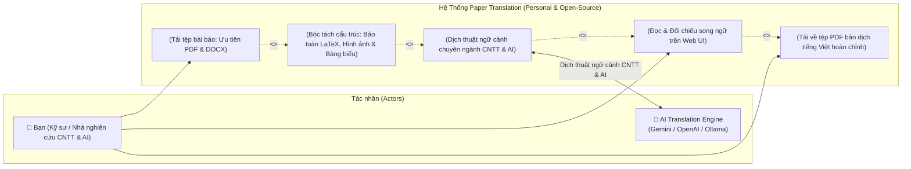
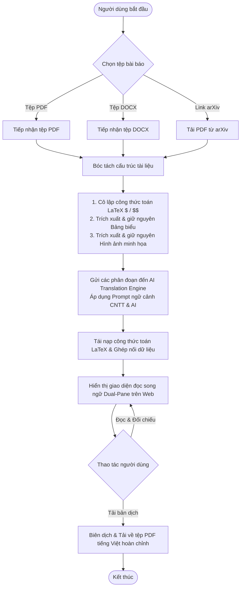

# 01 - Bối Cảnh Hệ Thống & Ranh Giới Phạm Vi (System Context & Boundary)

**Tầng tài liệu**: Architecture Layer (Single Source of Truth)  
**Hệ thống**: Paper Translation (Personal & Open-Source Edition)  
**Phiên bản**: 2.0 (Scaled Down & Focused)  
**Ngày cập nhật**: 2026-10-05  
**Trạng thái**: Approved  

---

## 1. Tổng quan Bối cảnh Hệ thống

Hệ thống **Paper Translation** được thiết kế lại theo hướng tinh giản tối đa, tập trung phục vụ **nhu cầu cá nhân** của nhà nghiên cứu / kỹ sư ngành **Công nghệ thông tin & Trí tuệ nhân tạo (IT & AI)** và hướng tới **mã nguồn mở (Open-Source)** cho cộng đồng.

Hệ thống loại bỏ toàn bộ các thành phần phức tạp của hệ thống SaaS thương mại (quản lý người dùng, phân quyền đa cấp, thanh toán) để tập trung giải quyết xuất sắc một bài toán duy nhất:
> **Tiếp nhận bài báo CNTT & AI (PDF hoặc DOCX) $\rightarrow$ Dịch chuẩn xác giữ 100% LaTeX, bảng biểu, hình ảnh $\rightarrow$ Đọc song ngữ trên Web $\rightarrow$ Tải về tệp PDF bản dịch tiếng Việt hoàn chỉnh.**

---

## 2. Định danh các Tác nhân (Actors & External Systems)

### 2.1. Tác nhân con người (Human Actor)
- **Cá nhân Nhà nghiên cứu / Kỹ sư CNTT & AI:**
  - Tải lên tệp bài báo định dạng **PDF** hoặc **DOCX** (hoặc dán liên kết arXiv).
  - Đọc và đối chiếu song ngữ trực tiếp trên giao diện Web UI (Dual-Pane).
  - Tải về tệp PDF bản dịch tiếng Việt hoàn chỉnh để lưu trữ ngoại tuyến hoặc in ấn học tập.

### 2.2. Hệ thống dịch vụ bên ngoài (External Services)
- **AI Translation Engine / LLM Provider:**
  - Cung cấp khả năng dịch thuật ngữ cảnh chuyên sâu CNTT & AI (Gemini API, OpenAI API hoặc mô hình chạy cục bộ Ollama / Local LLM).
- **arXiv Repository (Tùy chọn tiện ích):**
  - Cung cấp tệp bài báo công khai khi người dùng nhập link arXiv.

---

## 3. Sơ đồ Ranh giới Hệ thống & Use Case (System Boundary & Use Cases)

---

## 4. Dòng chảy Nghiệp vụ Tinh gọn (High-Level Process Flow)

---

## 5. Các Bất biến Hệ thống (System Invariants)

1. **Bất biến về Công thức Toán học:** 100% công thức toán học LaTeX (inline `$ $` và display `$$ $$` hoặc môi trường `\begin{equation}`) phải được cô lập tuyệt đối trước khi dịch và tái nạp nguyên vẹn vào bản dịch.
2. **Bất biến về Bảng biểu & Hình ảnh:** Bảng số liệu thực nghiệm và hình vẽ minh họa kiến trúc mô hình phải được bảo toàn nguyên vẹn vị trí tương đối trong bài viết.
3. **Bất biến về Tính đơn giản (Simplicity Invariant):** Không triển khai bất kỳ tính năng thừa thãi nào ngoài phạm vi: Nhập PDF/DOCX $\rightarrow$ Dịch CNTT/AI $\rightarrow$ Đọc song ngữ Web $\rightarrow$ Tải PDF bản dịch tiếng Việt.
