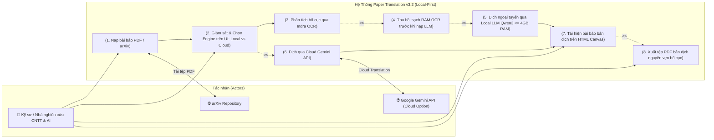
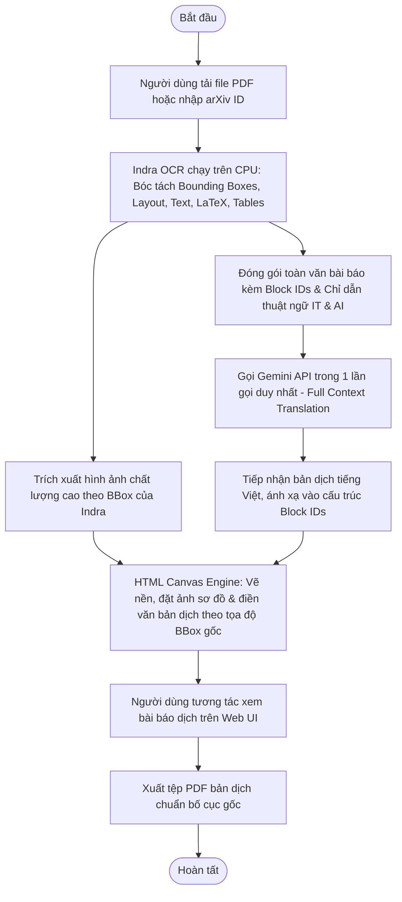

# 01 - Bối Cảnh Hệ Thống & Ranh Giới Phạm Vi (System Context & Boundary)

**Tầng tài liệu**: Architecture Layer (Single Source of Truth)  
**Hệ thống**: Paper Translation (Personal & Open-Source Edition)  
**Phiên bản**: 3.0 (Indra OCR, Single-Call Gemini & HTML Canvas Layout Edition)  
**Ngày cập nhật**: 2026-10-22  
**Trạng thái**: Approved  

---

## 1. Tổng quan Bối cảnh Hệ thống

Hệ thống **Paper Translation** phiên bản 3.2 chuyển đổi trọng tâm sang kiến trúc **Local-First (Ngoại Tuyến & Bảo Mật 100%)**:

> **Paper PDF $\rightarrow$ Indra OCR (Phân tích bố cục & văn bản) $\rightarrow$ [Thu hồi 100% RAM OCR] $\rightarrow$ Local LLM Engine (llama.cpp / Qwen3 GGUF $\le 4\text{GB}$ RAM) $\rightarrow$ HTML Canvas Layout Engine $\rightarrow$ Xuất PDF 1-click.**

---

## 2. Định danh các Tác nhân (Actors & Internal/External Systems)

### 2.1. Tác nhân con người (Human Actor)
- **Cá nhân Nhà nghiên cứu / Kỹ sư CNTT & AI:**
  - Tải lên tệp bài báo khoa học định dạng **PDF** (hoặc dán mã/liên kết arXiv).
  - Quan sát trạng thái xử lý trên UI thông qua **Engine Status Badge** (`Local LLM` vs `Cloud API`).
  - Trực tiếp xem và tương tác với bài báo bản dịch tiếng Việt trên giao diện **HTML Canvas** (giữ nguyên layout 2 cột, vị trí hình ảnh và bảng biểu như bản gốc).
  - Tải về tệp PDF bản dịch tiếng Việt hoàn chỉnh với 1 click.

### 2.2. Hệ thống dịch vụ xử lý (Processing Engines)
- **Local LLM Engine (`llama.cpp` + `Qwen3-1.7B-Q4_K_M.gguf` - Mặc định ưu tiên):**
  - Khởi tạo và quản lý trực tiếp bởi FastAPI backend; hoạt động ngoại tuyến 100% (chi phí 0đ, bảo mật dữ liệu tuyệt đối).
  - Giới hạn trần cứng: `n_ctx=8192` (mặc định ~2.8GB RAM), tối đa không vượt quá `16384` ($\le 4.0\text{ GB}$ RAM).
- **Google Gemini API (Cloud LLM - Tùy chọn thứ hai):**
  - Cung cấp khả năng dịch Single-Call toàn bài khi người dùng chọn chế độ Cloud.
- **arXiv Repository (Tùy chọn tiện ích):**
  - Tự động tải tệp PDF bài báo gốc khi người dùng nhập URL hoặc arXiv ID.

---

## 3. Sơ đồ Ranh giới Hệ thống & Use Case (System Boundary & Use Cases)

---

## 4. Dòng chảy Nghiệp vụ (High-Level Process Flow)

