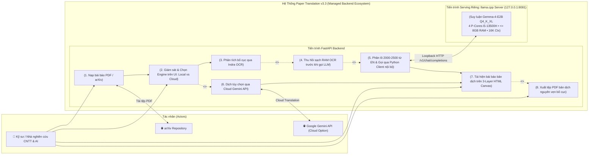
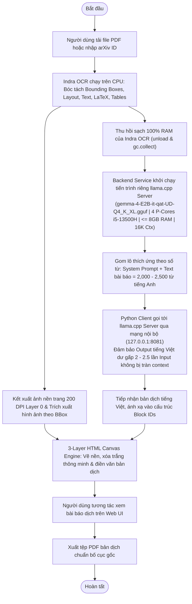

# 01 - Bối Cảnh Hệ Thống & Ranh Giới Phạm Vi (System Context & Boundary)

**Tầng tài liệu**: Architecture Layer (Single Source of Truth)  
**Hệ thống**: Paper Translation (Personal & Open-Source Edition)  
**Phiên bản**: 3.3 (Indra OCR, Standalone Llama.cpp Server + Gemma-4-E2B & 3-Layer HTML Canvas Edition)  
**Ngày cập nhật**: 2026-10-23  
**Trạng thái**: Approved  

---

## 1. Tổng quan Bối cảnh Hệ thống

Hệ thống **Paper Translation** phiên bản 3.3 áp dụng kiến trúc **Standalone Local-First Serving (Tách Biệt Tiến Trình Suy Luận & Tối Ưu Phần Cứng)**:

> **Paper PDF $\rightarrow$ Indra OCR (Phân tích bố cục & văn bản) $\rightarrow$ [Thu hồi 100% RAM OCR] $\rightarrow$ Python Internal Client $\leftrightarrow$ Standalone `llama.cpp` Server (`gemma-4-E2B-it-qat-UD-Q4_K_XL.gguf` • 4 P-Cores i5-13500H • $\le 8\text{GB}$ RAM • 16K/8K Ctx) $\rightarrow$ 3-Layer HTML Canvas Layout Engine $\rightarrow$ Xuất PDF 1-click.**

---

## 2. Định danh các Tác nhân (Actors & Internal/External Systems)

### 2.1. Tác nhân con người (Human Actor)
- **Cá nhân Nhà nghiên cứu / Kỹ sư CNTT & AI:**
  - Tải lên tệp bài báo khoa học định dạng **PDF** (hoặc dán mã/liên kết arXiv).
  - Quan sát trạng thái xử lý trên UI thông qua **Engine Status Badge** (`Local LLM: Gemma-4-E2B` vs `Cloud API`).
  - Trực tiếp xem và tương tác với bài báo bản dịch tiếng Việt trên giao diện **HTML Canvas** (giữ nguyên layout 2 cột, vị trí hình ảnh và bảng biểu như bản gốc).
  - Tải về tệp PDF bản dịch tiếng Việt hoàn chỉnh với 1 click.

### 2.2. Hệ thống dịch vụ xử lý (Processing Engines)
- **Standalone Local `llama.cpp` Server (`gemma-4-E2B-it-qat-UD-Q4_K_XL.gguf` - Mặc định ưu tiên):**
  - Được cài đặt trực tiếp từ thư viện `llama.cpp` gốc thông qua `uv/pip`, không nhúng gộp vào bên trong tiến trình FastAPI mà chạy như một **dịch vụ serving riêng biệt** dưới sự quản lý vòng đời của Backend.
  - Giao tiếp với FastAPI thông qua **Python Async HTTP Client** qua mạng nội bộ (`http://127.0.0.1:8081/v1/chat/completions`).
  - Cấu hình phần cứng chuyên biệt: Khai thác **4 P-cores trên Intel Core i5-13500H**, cho phép tăng tốc phần cứng, giới hạn trần cứng **RAM $\le 8.0\text{ GB}$**, cửa sổ ngữ cảnh **16K tokens (`n_ctx=16384`)** (hoặc tùy chọn 8K).
  - Quy tắc phân lô: Mỗi lượt gọi đóng gói **2,000 – 2,500 từ tiếng Anh** (bao gồm System Prompt + Text của bài báo), dành dư không gian đầu ra gấp **2.0 – 2.5 lần** cho văn bản tiếng Việt để không bao giờ bị tràn context.
- **Google Gemini API (Cloud LLM - Tùy chọn thứ hai):**
  - Cung cấp khả năng dịch Single-Call toàn bài khi người dùng chọn chế độ Cloud.
- **arXiv Repository (Tùy chọn tiện ích):**
  - Tự động tải tệp PDF bài báo gốc khi người dùng nhập URL hoặc arXiv ID.

---

## 3. Sơ đồ Ranh giới Hệ thống & Use Case (System Boundary & Use Cases v3.3)

---

## 4. Dòng chảy Nghiệp vụ (High-Level Process Flow v3.3)

