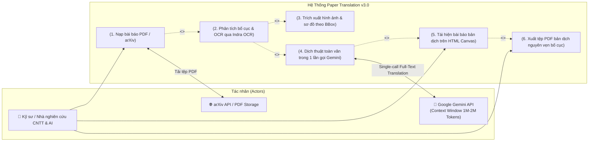

# 01 - Bối Cảnh Hệ Thống & Ranh Giới Phạm Vi (System Context & Boundary)

**Tầng tài liệu**: Architecture Layer (Single Source of Truth)  
**Hệ thống**: Paper Translation (Personal & Open-Source Edition)  
**Phiên bản**: 3.0 (Indra OCR, Single-Call Gemini & HTML Canvas Layout Edition)  
**Ngày cập nhật**: 2026-10-22  
**Trạng thái**: Approved  

---

## 1. Tổng quan Bối cảnh Hệ thống

Hệ thống **Paper Translation** phiên bản 3.0 khắc phục triệt để các sai lầm của các phiên bản trước đó (chia nhỏ đoạn gây mất ngữ cảnh, vỡ bố cục 2 cột và mất hình ảnh). Hệ thống được thiết kế theo luồng kiến trúc mới:

> **Paper PDF $\rightarrow$ Indra OCR (Layout, Text, Reading Order, LaTeX, Tables) $\rightarrow$ Gemini API (Dịch toàn văn 1 lần duy nhất) $\rightarrow$ HTML Canvas Layout Engine (Tái hiện bài báo như bản gốc trên Web) $\rightarrow$ Xuất PDF 1-click.**

---

## 2. Định danh các Tác nhân (Actors & External Systems)

### 2.1. Tác nhân con người (Human Actor)
- **Cá nhân Nhà nghiên cứu / Kỹ sư CNTT & AI:**
  - Tải lên tệp bài báo khoa học định dạng **PDF** (hoặc dán mã/liên kết arXiv).
  - Trực tiếp xem và tương tác với bài báo bản dịch tiếng Việt trên giao diện **HTML Canvas** (giữ nguyên layout 2 cột, vị trí hình ảnh và bảng biểu như bản gốc).
  - Tải về tệp PDF bản dịch tiếng Việt hoàn chỉnh với 1 click.

### 2.2. Hệ thống dịch vụ bên ngoài (External Services)
- **Google Gemini API (Cloud LLM - Single Call):**
  - Cung cấp khả năng tiếp nhận toàn bộ bài báo trong 1 lần gọi duy nhất nhờ cửa sổ ngữ cảnh khổng lồ (1M–2M tokens), đảm bảo tính nhất quán và bảo toàn ngữ cảnh học thuật tuyệt đối.
- **arXiv Repository (Tùy chọn tiện ích):**
  - Tự động tải tệp PDF bài báo gốc khi người dùng nhập URL hoặc arXiv ID.

---

## 3. Sơ đồ Ranh giới Hệ thống & Use Case (System Boundary & Use Cases)

---

## 4. Dòng chảy Nghiệp vụ (High-Level Process Flow)

