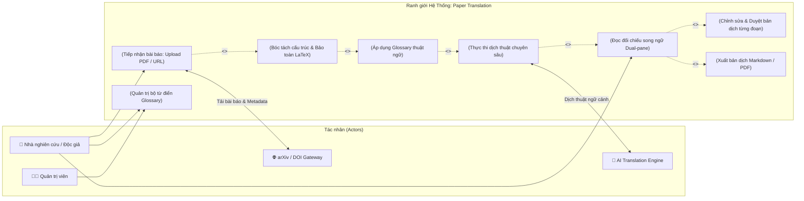
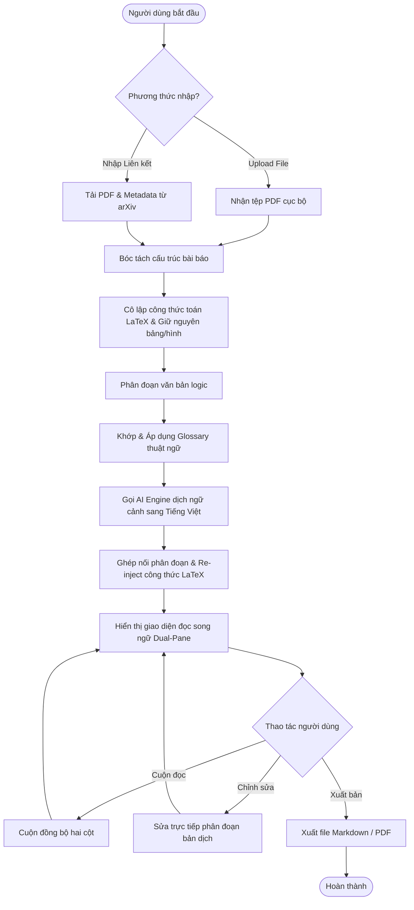

# 01 - Bối Cảnh Hệ Thống & Ranh Giới Phạm Vi (System Context & Boundary)

**Tầng tài liệu**: Architecture Layer (Single Source of Truth)  
**Hệ thống**: Paper Translation  
**Phiên bản**: 1.0  
**Ngày cập nhật**: 2026-10-05  
**Trạng thái**: Approved  

---

## 1. Tổng quan Bối cảnh Hệ thống (System Context)

Hệ thống **Paper Translation** là nền tảng tiếp nhận, phân tích bóc tách và dịch thuật tài liệu khoa học chuyên sâu sang tiếng Việt. Hệ thống tương tác với các tác nhân người dùng (Actors) và các hệ thống dịch vụ bên ngoài (External Services) nhằm cung cấp trải nghiệm đọc song ngữ tối ưu mà vẫn bảo toàn nguyên vẹn cấu trúc học thuật.

---

## 2. Định danh các Tác nhân (Actors & External Systems)

### 2.1. Tác nhân con người (Human Actors)
1. **Researcher / Reader (Người nghiên cứu / Độc giả):**
   - Tải lên tệp PDF hoặc dán link arXiv để dịch.
   - Đọc, tra cứu và đối chiếu song ngữ trên giao diện Dual-pane.
   - Chỉnh sửa, duyệt bản dịch từng đoạn và xuất tài liệu kết quả.
2. **System Administrator (Quản trị viên hệ thống):**
   - Quản lý cấu hình hệ sinh thái dịch thuật.
   - Thiết lập, chuẩn hóa và kiểm duyệt các bộ từ điển thuật ngữ (Glossary) hệ thống.

### 2.2. Hệ thống bên ngoài (External Systems)
1. **arXiv Repository & DOI Gateway:**
   - Cung cấp dịch vụ tải tài liệu bài báo công khai và siêu dữ liệu (Metadata) thông qua API hoặc web crawler an toàn.
2. **AI Translation Services & Large Language Models:**
   - Cung cấp năng lực dịch thuật ngữ cảnh chuyên sâu, hiểu biết thuật ngữ khoa học và xử lý ngôn ngữ tự nhiên.

---

## 3. Sơ đồ Ranh giới Hệ thống & Use Case (System Boundary & Use Cases)

Sơ đồ thể hiện toàn bộ các chức năng cốt lõi nằm trong ranh giới của hệ thống Paper Translation và sự tương tác với các tác nhân bên ngoài:

---

## 4. Dòng chảy nghiệp vụ mức cao (High-Level Process Flow)

Dòng dữ liệu từ khi tài liệu được đưa vào hệ thống cho tới khi hoàn tất bản dịch:

---

## 5. Ranh giới Trách nhiệm & Bất biến Hệ thống (Architectural Invariants)

1. **Bất biến về công thức toán:** Không một tiến trình xử lý ngôn ngữ tự nhiên nào được phép ghi đè, sửa đổi hoặc làm mất cú pháp của các khối công thức toán học (`$ ... $` hoặc `$$ ... $$`).
2. **Bất biến về tính đối xứng song ngữ:** Mọi văn bản đã dịch phải duy trì định danh phân đoạn (Segment ID) liên kết ánh xạ 1-1 với phân đoạn gốc để đảm bảo tính năng cuộn đồng bộ và biên tập chính xác.
3. **Bất biến về kiểm soát Glossary:** Thuật ngữ đã được quy định trong Glossary bắt buộc phải được ưu tiên chuẩn hóa trong câu dịch, ngăn chặn sự dịch sai lệch ngẫu nhiên.
