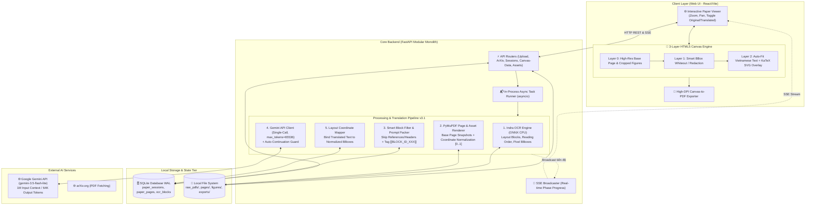

# 02 - Kiến Trúc Tổng Thể Hệ Thống (High-Level System Architecture)

**Tầng tài liệu**: Architecture Layer (Single Source of Truth)  
**Hệ thống**: Paper Translation (Personal & Open-Source Edition)  
**Phiên bản**: 3.1 (Reviewed & Hardened — Indra OCR, Single-Call Gemini & 3-Layer HTML Canvas)  
**Ngày cập nhật**: 2026-10-22  
**Trạng thái**: Approved  

---

## 1. Bối cảnh & Mục tiêu Tái thiết kế Kiến trúc

Kiến trúc phiên bản 3.1 giải quyết triệt để các sai lầm của kiến trúc cũ (v2.0) đồng thời khắc phục 4 rủi ro kỹ thuật cốt lõi khi xử lý bài báo khoa học thực tế:

1. **Chấm dứt chia cắt đoạn (Chunking) & Kiểm soát giới hạn Output Token:**
   - Tận dụng cửa sổ ngữ cảnh 1M tokens và tốc độ vượt trội, chi phí cực rẻ của mô hình mặc định **`gemini-3.5-flash-lite`** để dịch toàn bộ bài báo trong **1 lần gọi duy nhất (Single-Call)**.
   - **Bộ lọc thông minh trước khi dịch (Smart Pre-Filter):** Tự động giữ nguyên phần *References / Bibliography*, tiêu đề đầu/cuối trang (*page header/footer*) và các công thức độc lập, giúp tiết kiệm 25–35% lượng output tokens và tránh dịch sai tên tài liệu tham khảo.
   - **Cơ chế Auto-Continuation Guard:** Trong trường hợp bài báo cực dài (> 40 trang) chạm trần `finish_reason == "length"`, hệ thống tự động gọi tiếp nối từ `[[BLOCK_ID_XXX]]` cuối cùng với toàn bộ ngữ cảnh vẫn được giữ nguyên.
2. **Chuẩn hóa OCR & Hệ tọa độ qua Indra OCR (`datalab-to/indra`):**
   - Sử dụng mô hình `indra_ocr` chạy trên ONNX Runtime (CPU) để nhận diện cấu trúc 2 cột, thứ tự đọc (`reading_order`), nhãn khối (`label`: `text`, `section header`, `table`, `caption`, `footnote`, `list`, `page header`, `page footer`) và tọa độ hộp.
   - **Chuẩn hóa Tọa độ Bất biến (Normalized Coordinates `[0.0 .. 1.0]`):** Chuyển đổi toàn bộ tọa độ pixel từ Indra OCR sang hệ tọa độ chuẩn hóa tương đối `[x0_norm, y0_norm, x1_norm, y1_norm]` theo kích thước trang. Nhờ đó, PyMuPDF và HTML Canvas ở mọi mức DPI/Zoom đều ánh xạ chính xác tuyệt đối 100%.
3. **Cơ chế Tái hiện 3 Lớp trên HTML Canvas (3-Layer Erase-and-Redraw Canvas Architecture):**
   - Trong bài báo khoa học (LaTeX/arXiv), rất nhiều hình vẽ là đồ họa vector (TikZ, PGFPlots) chứ không chỉ là ảnh bitmap nhúng, và Indra OCR không phải lúc nào cũng gom trọn một sơ đồ vector phức tạp vào một block `figure` duy nhất.
   - Do đó, thay vì vẽ lại từ đầu trên nền trắng tinh (dễ làm mất sơ đồ vector, đường kẻ bảng, logo và công thức display), hệ thống áp dụng **Kiến trúc Canvas 3 Lớp**:
     - **Lớp 0 (Base Page Snapshot Layer):** Kết xuất trang PDF gốc ở độ phân giải cao làm lớp nền cơ sở (đồng thời hỗ trợ crop rời từng khối ảnh minh họa khi cần). Điều này bảo toàn **100% hình vẽ vector, đồ thị, đường kẻ bảng và công thức toán học độc lập**.
     - **Lớp 1 (Smart Text-Block Redaction / Whiteout Layer):** Chỉ xóa (phủ màu nền trắng `#FFFFFF`) đúng vùng Bounding Box của các khối văn bản đã được dịch (`text`, `section header`, `caption`, `list`, `footnote`), giữ nguyên toàn bộ vùng đồ họa xung quanh.
     - **Lớp 2 (Math-Aware Translated Typography Layer):** Vẽ đè văn bản tiếng Việt đã dịch vào đúng Bounding Box vừa xóa, kết hợp **Font Auto-scaling** và **KaTeX SVG `foreignObject`** để hiển thị sắc nét cả chữ tiếng Việt lẫn công thức toán học inline (`$...$`).

---

## 2. Ước lượng Quy mô & Hiệu năng (BOTEC Estimation)

### 2.1. Nhu cầu tính toán & Token Budget
- **Kích thước bài báo tiêu chuẩn:** 10 – 25 trang (~6,000 – 15,000 từ tiếng Anh).
- **Input Tokens gửi Gemini (sau khi lọc References):** ~6,000 – 18,000 tokens.
- **Output Tokens tiếng Việt nhận về:** ~8,000 – 24,000 tokens (nằm gọn trong trần `max_tokens = 65,536` của `gemini-3.5-flash-lite`).
- **Tài nguyên phần cứng:** Indra OCR chạy trên CPU qua ONNX Runtime (~300MB RAM), không yêu cầu GPU.

### 2.2. Chỉ tiêu chất lượng dịch vụ (SLA & Latency Targets)
- **Tiếp nhận & lưu trữ tệp PDF:** P99 $< 1.0$ giây.
- **Indra OCR & Kết xuất Base Page Images (15 trang):** P95 $< 12$ – $18$ giây trên CPU đa nhân.
- **Dịch thuật toàn văn qua Gemini (Single-Call):** P95 $< 15$ – $25$ giây cho toàn bộ bài báo.
- **Tái hiện Canvas 3 lớp trên Web:** P95 $< 0.3$ giây/trang.
- **Xuất file PDF hoàn chỉnh:** P95 $< 3.0$ giây.

---

## 3. Sơ đồ Tôpô Kiến trúc Tổng thể (High-Level Topology v3.1)

---

## 4. Ma trận Đánh giá Đánh đổi Kỹ thuật (Technical Trade-Offs v3.1)

| Thành phần | Lựa chọn kiến trúc v3.1 | What it solves (Giải quyết vấn đề gì) | What it worsens (Gây ra gánh nặng gì) | Change it when (Thay đổi khi nào) |
|---|---|---|---|---|
| **OCR & Phân tích Layout** | Indra OCR (`indra_ocr` ONNX CPU) + Chuẩn hóa tọa độ `[0..1]` | **Giải quyết triệt để lỗi đọc lộn 2 cột** và giải quyết sai lệch hệ tọa độ giữa DPI của OCR, PDF Points (72 DPI) và màn hình Retina. | Cần bước quy đổi tọa độ `(x / page_w, y / page_h)` ngay sau khi nhận kết quả từ `indra_ocr`. | Giữ nguyên vì đảm bảo tính bất biến toán học trên mọi thiết bị hiển thị. |
| ** Bảo toàn Hình ảnh & Sơ đồ Vector** | 3-Layer Canvas (Base Page Snapshot + Smart BBox Redaction) | **Bảo toàn 100% mọi sơ đồ vector (TikZ), biểu đồ, đường kẻ bảng và công thức toán độc lập** ngay cả khi OCR không nhận diện riêng vùng ảnh. | Cần lưu ảnh nền của từng trang (`pages/page_X.png`, ~200KB/trang) bên cạnh các ảnh crop. | Với ổ cứng cá nhân (1 bài báo 15 trang chỉ tốn ~3MB ảnh trang), chi phí lưu trữ là không đáng kể. |
| **Chiến lược Dịch thuật** | Gemini Single-Call (`max_tokens=65536`) + Lọc bỏ `References` + Auto-Continuation | **Bảo toàn 100% ngữ cảnh toàn bài**, không bao giờ bị cắt cụt giữa chừng do chạm trần output token, không dịch nhầm tên bài báo trong mục Tài liệu tham khảo. | Cần bộ parser kiểm tra các `[[BLOCK_ID_XXX]]` trả về và tự động gọi nối tiếp nếu bài báo quá dài (> 40 trang). | Luôn duy trì cơ chế bảo vệ này. |
| **Hiển thị Văn bản & Toán trên Canvas** | Auto-Fit Typography + KaTeX SVG `foreignObject` trên Canvas | **Hiển thị hoàn hảo cả văn bản tiếng Việt lẫn ký hiệu toán học inline (`$...$`)** ngay trên Canvas mà không bị in ra chuỗi code LaTeX thô. | Cần kết xuất khối có chứa toán học qua KaTeX HTML/SVG trước khi vẽ lên Canvas 2D context. | Hỗ trợ thêm lớp DOM Text Layer trong suốt phía trên nếu cần bôi đen copy văn bản. |
