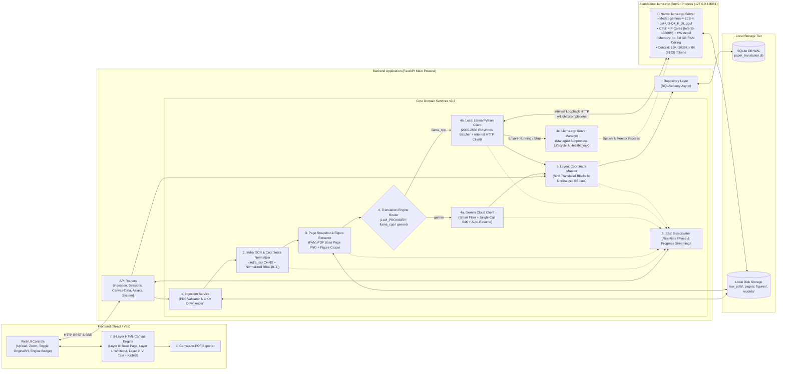

# 03 - Kiến Trúc Dịch Vụ & Phân Rã Thành Phần (Service Architecture & Decomposition)

**Tầng tài liệu**: Architecture Layer (Single Source of Truth)  
**Hệ thống**: Paper Translation (Personal & Open-Source Edition)  
**Phiên bản**: 3.3 (Indra OCR, Standalone Llama.cpp Server + Gemma-4-E2B & 3-Layer HTML Canvas)  
**Ngày cập nhật**: 2026-10-23  
**Trạng thái**: Approved  

---

## 1. Chiến lược Phân rã Dịch vụ (Modular Architecture + Standalone LLM Serving v3.3)

Hệ thống được tổ chức theo kiến trúc **FastAPI Backend kết hợp Dịch vụ Serving `llama.cpp` Độc lập (Standalone Managed Subprocess)**. Thay vì gộp chung mô hình LLM vào trong tiến trình FastAPI qua `llama-cpp-python`, Backend quản lý một service riêng khởi chạy trực tiếp `llama.cpp server` gốc và giao tiếp qua mạng nội bộ (`127.0.0.1`) bằng Python Client:

---

## 2. Đặc Tả Chi Tiết Từng Dịch Vụ (Detailed Service Specifications)

### 2.1. Ingestion Service (`ingestion_service.py`)
- **Nhiệm vụ:**
  - Xác thực tệp PDF tải lên (kiểm tra magic bytes `%PDF-`, dung lượng $\le 50\text{MB}$).
  - Tự động tải tệp PDF từ `https://arxiv.org/pdf/{arxiv_id}.pdf` khi người dùng nhập mã hoặc URL arXiv.
  - Lưu tệp gốc vào `storage/raw_pdfs/{session_id}.pdf`.

### 2.2. Indra OCR & Coordinate Normalizer Service (`indra_ocr_service.py`)
- **Nhiệm vụ:**
  - Sử dụng API Python chính thức của `indra_ocr` (`conv = indra_ocr.load(threads=4); conv.convert(pdf_path)`).
  - Thu thập danh sách các khối bố cục (`page.blocks`) theo thứ tự đọc chuẩn (`reading_order`), bao gồm:
    - `label`: Nhãn ngữ nghĩa của khối (`text`, `section header`, `title`, `table`, `caption`, `footnote`, `list`, `page header`, `page footer`, `figure`).
    - `box` / `bbox`: Tọa độ pixel trên trang đã được khử nghiêng (`rotation`, `skew`).
    - `text`: Nội dung văn bản hoặc bảng HTML/LaTeX của khối.
  - **Chuẩn hóa Hệ Tọa Độ (Coordinate Normalization):**
    - Quy đổi mọi tọa độ hộp từ pixel của ảnh OCR sang hệ tọa độ tỷ lệ tương đối `[x0_norm, y0_norm, x1_norm, y1_norm]` nằm trong đoạn `[0.0, 1.0]`.
  - **Thu Hồi Tài Nguyên Phần Cứng Triệt Để (`unload()`):**
    - Phương thức `unload()` gọi `pool.shutdown(wait=False, cancel_futures=True)` dừng ngay lập tức các luồng worker threads của ONNX Runtime.
    - Hủy tham chiếu tất cả `InferenceSession` (`det`, `rec`, `order`, `orient`, `mask`, `math`) và kích hoạt `gc.collect()` để giải phóng hoàn toàn bộ nhớ RAM trước khi tiến trình `llama.cpp server` hoạt động.

### 2.3. Page Snapshot & Figure Extractor Service (`page_asset_service.py`)
- **Nhiệm vụ:**
  - Dùng `PyMuPDF (fitz)` kết xuất từng trang PDF gốc thành ảnh nền độ phân giải cao (`storage/pages/{session_id}/page_{page_num}.png` ở 200 DPI) làm **Layer 0** cho HTML Canvas.
  - Bảo toàn **100% sơ đồ vector (TikZ/PGFPlots), biểu đồ, đường viền bảng và công thức toán học độc lập**.
  - Với các khối được đánh nhãn `figure` / `picture`, hệ thống hỗ trợ crop riêng thành `storage/figures/{session_id}/page_{p}_fig_{idx}.png`.

### 2.4. Standalone Llama.cpp Server Manager (`llama_server_manager.py`) & Python Client (`llama_client_service.py`)
- **Nhiệm vụ:**
  - **Tách Biệt Tiến Trình Serving (Standalone Service Managed by Backend):**
    - Tuyệt đối không dùng thư viện nhúng in-process `llama-cpp-python` gộp chung vào bên trong FastAPI.
    - Cài đặt trực tiếp bộ công cụ `llama.cpp` gốc thông qua `uv/pip` trong môi trường ảo `.venv`.
    - Xây dựng một service quản lý vòng đời riêng (`LlamaServerManager`) chịu trách nhiệm khởi chạy tiến trình độc lập `llama-server` (hoặc CLI server tương đương của `llama.cpp`), giám sát healthcheck (`/health`) và tắt tiến trình sạch sẽ khi giải phóng bộ nhớ.
  - **Khai Thác Mô Hình `gemma-4-E2B-it-qat-UD-Q4_K_XL.gguf` & Tối Ưu Phần Cứng:**
    - Nạp tệp mô hình `backend/storage/models/gemma-4-E2B-it-qat-UD-Q4_K_XL.gguf` (~2.62 GB).
    - **Tối ưu hóa CPU Intel Core i5-13500H:** Cấu hình sử dụng đúng **4 P-cores hiệu năng cao** (`--threads 4 --threads-batch 4`) để tránh luồng rơi vào E-cores gây suy giảm tốc độ.
    - **Cho phép tăng tốc phần cứng (Hardware Acceleration):** Bật hỗ trợ phần cứng (GPU/iGPU offloading, Flash Attention `--flash-attn`, AVX2/VNNI trên i5-13500H).
    - **Giới hạn trần cứng 8.0 GB RAM:** Kiểm soát tổng mức chiếm dụng bộ nhớ của tiến trình `llama.cpp server` luôn **$\le 8.0\text{ GB}$ RAM** (trọng số ~2.62 GB + KV Cache Q8_0 + Compute Buffer cho 16K context chỉ chiếm ~3.8 – 4.5 GB RAM).
  - **Tối Ưu Ngữ Cảnh 16K / 8K & Phân Lô Theo Số Từ (Word-Count Aware Batching):**
    - Cấu hình mặc định **`n_ctx = 16384` (16K tokens)** (hỗ trợ tùy chọn `8192` - 8K tokens).
    - **Quy tắc đóng gói Input (2,000 – 2,500 từ tiếng Anh):** Bộ phân lô tự động tính tổng số từ của **System Prompt + Text các khối bài báo** sao cho mỗi lần gọi nằm trong khoảng **2,000 đến 2,500 từ tiếng Anh** (~3,000 – 3,800 tokens).
    - **Quy tắc bảo toàn Output Tiếng Việt (Dự phòng gấp 2.0 – 2.5 lần):** Do văn bản tiếng Việt khi dịch ra có số lượng từ và token nhiều hơn gấp **2.0 – 2.5 lần** so với tiếng Anh (~6,500 – 9,500 tokens), hệ thống cấp phát trần sinh văn bản `max_tokens = 10240` trên cửa sổ ngữ cảnh `16384` tokens, đảm bảo **100% không bao giờ bị tràn context hay đứt gãy giữa chừng**.
  - **Giao Tiếp Qua Python Client Nội Bộ (`llama_client_service.py`):**
    - FastAPI sử dụng Python Client bất đồng bộ (`httpx.AsyncClient`) giao tiếp với `llama.cpp server` qua mạng loopback nội bộ (`http://127.0.0.1:8081/v1/chat/completions`).
    - Bảo toàn trọn vẹn thẻ định danh `[[BLK_XXXX]]`, công thức toán LaTeX `$..$` và bảng HTML `<table>`. Tự động fallback dịch bù nếu thiếu khối.

### 2.5. Cloud Gemini Full-Text Translator (`gemini_translator.py` - Tùy Chọn Thứ Hai)
- **Nhiệm vụ:**
  - Cung cấp tùy chọn dịch Single-Call toàn bài qua Google Gemini API (`max_tokens = 65536`) khi người dùng chuyển sang chế độ Cloud.
  - Hỗ trợ `Smart Translatable Filter` (bỏ qua `page header/footer`, `figure` và `References`).

### 2.6. Layout Coordinate Mapper (`layout_mapper.py`)
- **Nhiệm vụ:**
  - Ánh xạ từng bản dịch tiếng Việt vào đúng bản ghi `ocr_blocks` trong SQLite.
  - Cung cấp dữ liệu hoàn chỉnh qua endpoint `GET /api/v1/sessions/{session_id}/canvas-data`.

### 2.7. Frontend 3-Layer HTML Canvas Engine (`CanvasPaperViewer.tsx`)
- **Nhiệm vụ:**
  - **Layer 0 (Base Page):** Vẽ `page_image_url` lên toàn bộ diện tích Canvas.
  - **Layer 1 (Smart Redaction):** Vẽ hình chữ nhật màu nền (`#FFFFFF`) phủ kín tọa độ `[x0 * W, y0 * H, (x1 - x0) * W, (y1 - y0) * H]` của các khối đã dịch.
  - **Layer 2 (Translated Text & Math Rendering):** Dùng Binary-Search Font Auto-Scaling và KaTeX SVG `foreignObject` để vẽ văn bản tiếng Việt và công thức toán sắc nét.
  - Hỗ trợ xem đối chiếu và xuất toàn bộ các trang Canvas ra tệp PDF chất lượng cao.
