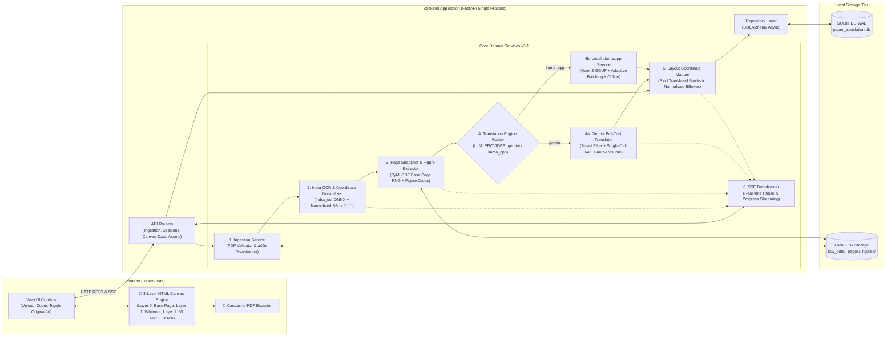

# 03 - Kiến Trúc Dịch Vụ & Phân Rã Thành Phần (Service Architecture & Decomposition)

**Tầng tài liệu**: Architecture Layer (Single Source of Truth)  
**Hệ thống**: Paper Translation (Personal & Open-Source Edition)  
**Phiên bản**: 3.1 (Reviewed & Hardened — Indra OCR, Single-Call Gemini & 3-Layer HTML Canvas)  
**Ngày cập nhật**: 2026-10-22  
**Trạng thái**: Approved  

---

## 1. Chiến lược Phân rã Dịch vụ (Modular Architecture v3.1)

Hệ thống được tổ chức theo kiến trúc **Self-Contained Modular Monolith** (FastAPI + SQLite WAL + Local Disk), đảm bảo chạy mượt mà bằng 1 lệnh duy nhất mà không cần Redis hay GPU:

---

## 2. Đặc Tả Chi Tiết Từng Dịch Vụ (Detailed Service Specifications)

### 2.1. Ingestion Service (`ingestion_service.py`)
- **Nhiệm vụ:**
  - Xác thực tệp PDF tải lên (kiểm tra magic bytes `%PDF-`, dung lượng $\le 50\text{MB}$).
  - Tự động tải tệp PDF từ `https://arxiv.org/pdf/{arxiv_id}.pdf` khi người dùng nhập mã hoặc URL arXiv.
  - Lưu tệp gốc vào `storage/raw_pdfs/{session_id}.pdf`.

### 2.2. Indra OCR & Coordinate Normalizer Service (`indra_ocr_service.py`)
- **Nhiệm vụ:**
  - Sử dụng API Python chính thức của `indra_ocr` (`conv = indra_ocr.load(threads=4); conv.convert(pdf_path)`).
  - Thu thập danh sách các khối bố cục (`page.blocks`) theo thứ tự đọc chuẩn (`reading_order`), bao gồm:
    - `label`: Nhãn ngữ nghĩa của khối (`text`, `section header`, `title`, `table`, `caption`, `footnote`, `list`, `page header`, `page footer`, `figure`).
    - `box` / `bbox`: Tọa độ pixel trên trang đã được khử nghiêng (`rotation`, `skew`).
    - `text`: Nội dung văn bản hoặc bảng HTML/LaTeX của khối.
  - **Chuẩn hóa Hệ Tọa Độ (Coordinate Normalization):**
    - Quy đổi mọi tọa độ hộp từ pixel của ảnh OCR sang hệ tọa độ tỷ lệ tương đối `[x0_norm, y0_norm, x1_norm, y1_norm]` nằm trong đoạn `[0.0, 1.0]` theo chiều rộng và chiều cao trang:
      $$x_{\text{norm}} = \frac{x_{\text{px}}}{W_{\text{ocr}}}, \quad y_{\text{norm}} = \frac{y_{\text{px}}}{H_{\text{ocr}}}$$
    - Nhờ hệ tọa độ `[0.0 .. 1.0]`, mọi sai lệch về DPI giữa Indra OCR, PyMuPDF (72 DPI) và HTML Canvas đều được loại bỏ hoàn toàn.
  - **Thu Hồi Tài Nguyên Phần Cứng Triệt Để (`unload()`):**
    - Phương thức `unload()` gọi `pool.shutdown(wait=False, cancel_futures=True)` dừng ngay lập tức các luồng worker threads của ONNX Runtime nhằm tránh chiếm dụng CPU.
    - Hủy tham chiếu tất cả `InferenceSession` (`det`, `rec`, `order`, `orient`, `mask`, `math`) và kích hoạt `gc.collect()` để giải phóng hoàn toàn bộ nhớ RAM.
    - Hỗ trợ Context Manager (`with IndraOcrService() as svc`) và tự động thực thi trong khối `finally:` của tiến trình nền.

### 2.3. Page Snapshot & Figure Extractor Service (`page_asset_service.py`)
- **Nhiệm vụ:**
  - Dùng `PyMuPDF (fitz)` kết xuất từng trang PDF gốc thành ảnh nền độ phân giải cao (`storage/pages/{session_id}/page_{page_num}.png` ở 200 DPI) làm **Layer 0** cho HTML Canvas.
  - Việc có sẵn ảnh nền trang gốc (Layer 0) đảm bảo **100% sơ đồ vector (TikZ/PGFPlots), biểu đồ, đường viền bảng và công thức toán học độc lập** luôn hiển thị nguyên vẹn trên Canvas ngay cả khi OCR không đóng khung riêng cho hình vẽ.
  - Đồng thời, với các khối được đánh nhãn `figure` / `picture`, hệ thống hỗ trợ crop riêng thành `storage/figures/{session_id}/page_{p}_fig_{idx}.png` để phục vụ xem chi tiết.
  - Tự động đóng tài liệu `doc.close()`, xóa bộ nhớ ảnh raster `del pix` và thu gom rác sau khi kết xuất để tối ưu RAM.

### 2.4. Universal Translator & Gemini Full-Text Engine (`gemini_translator.py`)
- **Nhiệm vụ:**
  - **Chuẩn Hóa Giao Thức OpenAI-Compatible (/v1/chat/completions):**
    - Hỗ trợ toàn diện Google Gemini (`gemini-3.5-flash-lite`), OpenAI ChatGPT (`gpt-4o-mini`), và các mô hình cục bộ / tự host (**Ollama**, **LM Studio**, **Llama.cpp**, **vLLM**, self-hosted translation models).
    - Tự động nhận diện và chuẩn hóa URL endpoint (`normalized_llm_endpoint`).
  - **Bước 1 — Bộ lọc Khối Cần Dịch (Smart Translatable Filter):**
    - Đánh dấu `is_translatable = False` đối với:
      1. Các khối `page header`, `page footer` (số trang, tên hội nghị ở lề trang).
      2. Các khối thuộc mục **References / Bibliography** (bắt đầu từ tiêu đề `References` hoặc `Bibliography` ở cuối bài báo) — vì tài liệu tham khảo quốc tế cần giữ nguyên tên tiếng Anh để tra cứu và chiếm tới 20–30% độ dài bài báo.
      3. Các khối chỉ chứa ký hiệu toán học thuần túy hoặc số liệu.
  - **Bước 2 — Điều Phối Kênh Dịch (Single-Call vs. Adaptive Batching):**
    - **Single-Call Toàn văn (Cloud Models - Gemini 1M Context):** Đóng gói toàn bộ các khối `is_translatable = True` dạng `[[BLK_0001]]`..`[[BLK_NNNN]]` và gửi trong 1 request duy nhất với `max_tokens = 65536`.
    - **Adaptive Batching (Local Models - Ollama, LM Studio, Llama.cpp):** Tự động phân tách danh sách khối thành các lô nhỏ (~1,500 tokens / 8 khối mỗi batch) để thích ứng hoàn hảo với các mô hình local có Context Window nhỏ (4k–8k tokens) mà không bị lỗi tràn VRAM (OOM).
  - **Bước 3 — Cơ Chế Callback Thời Gian Thực & Xử Lý Sự Cố (Retries & Backoff):**
    - Hỗ trợ `ProgressCallback` cập nhật tiến trình liên tục tới kênh SSE `broadcaster.emit`.
    - Cơ chế **Exponential Backoff**: Tự động thử lại khi gặp HTTP 429 Rate Limit (tôn trọng header `Retry-After`), lỗi máy chủ HTTP 5xx, hoặc lỗi mạng/timeout.
    - Cơ chế **Auto-Continuation Guard**: Tiếp nối tự động cho các khối còn thiếu nếu gặp `finish_reason == "length"`.
    - Fallback an toàn sang `MockTranslator` nếu mọi nỗ lực kết nối mạng đều thất bại.

### 2.5. Local Llama.cpp Translation Service (`llama_service.py` - Local-First Core)
- **Nhiệm vụ:**
  - **Động Cơ Dịch Thuật Mặc Định (Local-First Architecture):**
    - Đóng vai trò là công cụ dịch thuật mặc định ưu tiên số 1 của hệ thống, vận hành 100% ngoại tuyến (chi phí 0đ, bảo mật tuyệt đối).
    - Tự động nạp mô hình lượng hóa `Qwen3-1.7B-Q4_K_M.gguf` từ thư mục `backend/storage/models/`.
  - **Khóa Trần Cứng 4GB RAM (Hard 4.0GB RAM Ceiling):**
    - Mặc định khởi tạo ngữ cảnh `n_ctx = 8192` (8K tokens) tiêu tốn ~2.8 GB RAM (1.03 GB model weights + 1.5 GB KV Cache + buffer).
    - Thiết lập giới hạn trần cứng `max_n_ctx = 16384` (16K tokens) tiêu tốn tối đa 4.0 GB RAM. Nghiêm cấm mọi tham số vượt quá 4GB RAM để chừa tài nguyên cho hệ điều hành và các ứng dụng khác của người dùng.
  - **Quản Lý Vòng Đời Tuần Tự (Sequential Mutex Lifecycle):**
    - Tuân thủ quy tắc cô lập bộ nhớ tuyệt đối: Không bao giờ nạp LLM khi Indra OCR chưa giải phóng sạch.
    - Cung cấp phương thức `unload()` tường minh để thu hồi bộ nhớ RAM/VRAM khi có tác vụ OCR mới hoặc khi kết thúc phiên.
  - **Dịch Thuật Ngoại Tuyến Qua Phân Lô Thích Ứng (Offline Adaptive Batching):**
    - Chia cụm 6–8 khối văn bản liên tiếp (~1,500 tokens) để suy luận cục bộ, bảo toàn trọn vẹn thẻ định danh `[[BLK_XXXX]]`, công thức toán LaTeX `$..$` và bảng HTML `<table>`.
    - Tự động fallback dịch từng khối riêng lẻ nếu mô hình bỏ sót thẻ trong cụm batch.
  - **Đồng Bộ Dữ Liệu:** Trả về kết quả từ điển `{block_id: translated_text}` đồng nhất với giao diện của `GeminiTranslator` để lưu vào SQLite và hiển thị trên Canvas.

### 2.6. Layout Coordinate Mapper (`layout_mapper.py`)
- **Nhiệm vụ:**
  - Ánh xạ từng bản dịch tiếng Việt vào đúng bản ghi `ocr_blocks` trong SQLite.
  - Cung cấp dữ liệu hoàn chỉnh qua endpoint `GET /api/v1/sessions/{session_id}/canvas-data` bao gồm kích thước chuẩn của từng trang (`width_pt`, `height_pt`, `page_image_url`) và danh sách các khối (`block_id`, `label`, `bbox_norm`, `original_text`, `translated_text`, `is_translatable`).

### 2.7. Frontend 3-Layer HTML Canvas Engine (`CanvasPaperViewer.tsx`)
- **Nhiệm vụ:**
  - Khởi tạo `<canvas>` cho từng trang theo đúng tỷ lệ `width_pt / height_pt` nhân với `devicePixelRatio` và mức `zoom`.
  - **Layer 0 (Base Page):** Vẽ `page_image_url` lên toàn bộ diện tích Canvas.
  - **Layer 1 (Smart Redaction):** Duyệt qua các khối có `is_translatable == true` và đã có `translated_text`; vẽ hình chữ nhật màu nền (`#FFFFFF`) phủ kín tọa độ `[x0 * W, y0 * H, (x1 - x0) * W, (y1 - y0) * H]` để xóa chữ tiếng Anh gốc mà không chạm vào bất kỳ hình ảnh hay sơ đồ nào bên ngoài hộp.
  - **Layer 2 (Translated Text & Math Rendering):**
    - Nếu khối chỉ chứa văn bản thuần: Dùng thuật toán Binary-Search Font Auto-Scaling (tìm cỡ chữ lớn nhất từ `6px` đến `28px` sao cho sau khi bẻ dòng `word-wrap` chiều cao văn bản nằm vừa khít trong chiều cao hộp `H_box`) và vẽ trực tiếp lên Canvas.
    - Nếu khối chứa công thức toán LaTeX (`$...$`, `$$...$$`) hoặc bảng HTML (`<table>`): Kết xuất thông qua KaTeX + SVG `foreignObject` và vẽ ảnh SVG sắc nét trực tiếp vào đúng tọa độ hộp trên Canvas.
  - Hỗ trợ chế độ xem đối chiếu (bật/tắt Layer 1+2 để xem tức thì bản gốc tiếng Anh bên dưới hoặc xem song song 2 trang) và xuất toàn bộ các trang Canvas ra tệp PDF chất lượng cao.
