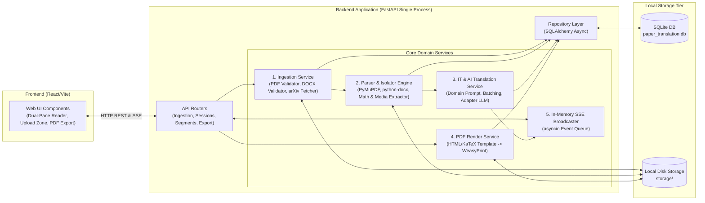

# 03 - Kiến Trúc Dịch Vụ & Phân Rã Thành Phần (Service Architecture & Decomposition)

**Tầng tài liệu**: Architecture Layer (Single Source of Truth)  
**Hệ thống**: Paper Translation (Personal & Open-Source Edition)  
**Phiên bản**: 2.0 (Scaled Down & Focused)  
**Ngày cập nhật**: 2026-10-05  
**Trạng thái**: Approved  

---

## 1. Chiến lược Phân rã Dịch vụ Tinh gọn (Lightweight Modular Architecture)

Để đảm bảo dự án có thể **chạy ngay lập tức trên máy tính cá nhân bằng 1 lệnh duy nhất** và **dễ dàng phân phối mở mã nguồn cho cộng đồng**, hệ thống loại bỏ các thành phần cụm phân tán (Redis, Celery, MinIO server) và quy hoạch thành một **Self-Contained Modular Monolith**:



---

## 2. Chi tiết các Phân hệ & Trách nhiệm (Subsystems & Responsibilities)

### 2.1. Phân hệ Tiếp nhận Tài liệu (Ingestion Subsystem)
- **Vị trí mã nguồn:** `backend/app/services/ingestion/`
- **Trách nhiệm:**
  - Tiếp nhận tệp tải lên từ Web UI, phân loại định dạng: **PDF** (MIME `%PDF-`) hoặc **DOCX** (MIME OpenXML zip).
  - Thu thập tệp và metadata từ liên kết hoặc mã bài báo arXiv (`arxiv_id`).
  - Lưu tệp gốc vào thư mục cục bộ `storage/raw/{session_id}/original.[pdf|docx]`.
  - Khởi tạo bản ghi `PaperSession` trong SQLite với trạng thái `PENDING`.

### 2.2. Phân hệ Bóc tách & Cô lập Học thuật (Parser & Preservation Engine)
- **Vị trí mã nguồn:** `backend/app/services/parser/`
- **Trách nhiệm:**
  - **Trình bóc tách PDF (`PdfParser`):** Sử dụng `PyMuPDF (fitz)` để trích xuất các khối văn bản (Text Blocks), tọa độ và nhận diện công thức toán học inline `$ ... $` và display `$$ ... $$`.
  - **Trình bóc tách DOCX (`DocxParser`):** Sử dụng `python-docx` để duyệt qua các đoạn văn bản (Paragraphs), bảng biểu (`tables`) và trích xuất hình ảnh nhúng (`InlineShapes`) lưu vào `storage/assets/{session_id}/`.
  - **Mô-đun cô lập (Isolator):** Thay thế toàn bộ công thức toán học bằng token bảo vệ an toàn `<<<MATH_TOKEN_NNN>>>` và lưu chuỗi LaTeX gốc vào bảng `math_tokens`.

### 2.3. Phân hệ Dịch thuật Chuyên sâu CNTT & AI (IT & AI Translation Engine)
- **Vị trí mã nguồn:** `backend/app/services/translation/`
- **Trách nhiệm:**
  - Đóng gói System Prompt chuyên biệt cho lĩnh vực **Công nghệ thông tin & Trí tuệ nhân tạo**, hướng dẫn LLM hiểu chuẩn mực các thuật ngữ *Attention, Transformer, Residual, Latent, Gradient, Backprop...*.
  - Gom các phân đoạn văn bản thành từng lô (Batch 5–10 phân đoạn) để tối ưu thời gian phản hồi và hạn mức API.
  - Hỗ trợ linh hoạt:
    - **Cloud API Adapter:** Tích hợp Google Gemini API (mặc định cho độ trễ nhanh và chi phí rẻ), OpenAI API, Claude API.
    - **Local LLM Adapter:** Tích hợp Ollama (`http://localhost:11434`) cho phép người dùng chạy hoàn toàn offline không cần internet.
  - Tái nạp chính xác các chuỗi LaTeX gốc vào văn bản tiếng Việt sau khi dịch.

### 2.4. Phân hệ Phát tiến trình Thời gian thực (SSE Broadcaster)
- **Vị trí mã nguồn:** `backend/app/services/sse/`
- **Trách nhiệm:**
  - Sử dụng cơ chế hàng đợi bất đồng bộ trong bộ nhớ (`asyncio.Queue`) gắn với từng `session_id`.
  - Đẩy sự kiện tiến trình qua endpoint `GET /api/v1/sessions/{session_id}/progress`:
    - `10%`: Đã tiếp nhận và lưu tệp.
    - `30%`: Đã bóc tách cấu trúc và cô lập công thức toán.
    - `35% -> 90%`: Tiến trình dịch từng phân đoạn (vd: 45/120 phân đoạn).
    - `100%`: Hoàn tất, sẵn sàng hiển thị trên Web song ngữ và tải PDF.

### 2.5. Phân hệ Kết xuất PDF Bản dịch (PDF Export Engine)
- **Vị trí mã nguồn:** `backend/app/services/export/`
- **Trách nhiệm:**
  - Nạp dữ liệu các phân đoạn tiếng Việt, hình ảnh kiến trúc và bảng số liệu thực nghiệm.
  - Đưa vào template HTML chuẩn học thuật (tích hợp KaTeX kết xuất công thức toán học sắc nét và CSS Paged Media dàn trang A4).
  - Biên dịch template thành tệp PDF hoàn chỉnh thông qua thư viện `WeasyPrint` và lưu tại `storage/exports/{session_id}/translated.pdf`.

---

## 3. Quy cách Đóng gói & Triển khai (Packaging & Deployment)

1. **Chế độ Chạy Cục bộ (Local Run — Dành cho phát triển & cá nhân):**
   ```bash
   # Backend: Chỉ cần Python 3.11+
   cd backend && uv run uvicorn app.main:app --port 8000 --reload
   # Frontend: Chỉ cần Node.js
   cd frontend && npm run dev
   ```
2. **Chế độ Đóng gói 1-Click Docker (Dành cho Open-Source chia sẻ cộng đồng):**
   - File `docker-compose.yml` duy nhất đóng gói cả Web UI và API Server.
   - Dữ liệu và tệp lưu trữ được mount vào thư mục volume cục bộ `./data:/app/storage`.
   - Khởi động toàn bộ ứng dụng chỉ với:
     ```bash
     docker compose up -d
     ```
