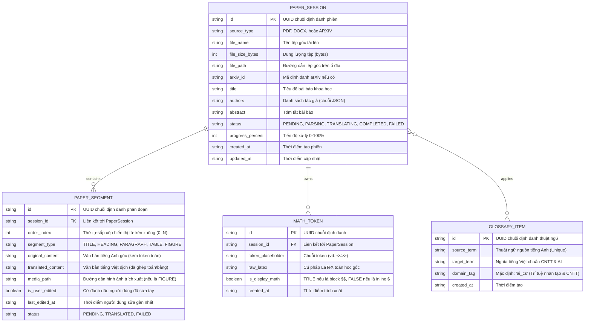

# 05 - Kiến Trúc Dữ Liệu & Mô Hình Lưu Trữ (Data Architecture & Storage Models)

**Tầng tài liệu**: Architecture Layer (Single Source of Truth)  
**Hệ thống**: Paper Translation (Personal & Open-Source Edition)  
**Phiên bản**: 2.0 (Scaled Down & Focused)  
**Ngày cập nhật**: 2026-10-05  
**Trạng thái**: Approved  

---

## 1. Chiến lược Lưu trữ Dữ liệu Tinh gọn (Lightweight Storage Strategy)

Để đảm bảo người dùng cá nhân và người dùng mã nguồn mở có thể **chạy ngay ứng dụng mà không cần cài đặt hoặc quản trị bất kỳ máy chủ cơ sở dữ liệu nào**, hệ thống áp dụng:
1. **Cơ sở dữ liệu SQLite (WAL Mode):**
   - Lưu trữ toàn bộ dữ liệu cấu trúc vào một tệp duy nhất `paper_translation.db`.
   - Bật chế độ **Write-Ahead Logging (WAL)**: Cho phép nhiều luồng đọc đồng thời mà không bị khóa luồng ghi, đáp ứng hiệu năng hoàn hảo cho ứng dụng Web cá nhân.
   - Sử dụng thư viện ORM **SQLAlchemy Async** (chuẩn bị sẵn sàng nếu người dùng muốn cấu hình trỏ sang PostgreSQL qua biến môi trường).
2. **Lưu trữ Tệp Cục bộ (Local File System):**
   - Lưu trữ tệp gốc PDF/DOCX, hình ảnh trích xuất và tệp PDF xuất ra trực tiếp trong thư mục `storage/` của ứng dụng.

---

## 2. Sơ đồ Quan hệ Thực thể (Entity-Relationship Diagram — ERD)



---

## 3. Đặc tả Chi tiết các Bảng Dữ liệu (Schema Specifications)

### 3.1. Bảng `paper_sessions`
| Cột | Kiểu dữ liệu | Ràng buộc | Mô tả nghiệp vụ |
|---|---|---|---|
| `id` | `VARCHAR(36)` | `PRIMARY KEY` | UUID phiên làm việc |
| `source_type` | `VARCHAR(20)` | `NOT NULL` | `PDF`, `DOCX`, hoặc `ARXIV` |
| `file_name` | `VARCHAR(255)` | `NOT NULL` | Tên tệp hiển thị |
| `file_size_bytes` | `INTEGER` | `NOT NULL` | Dung lượng tệp tải lên |
| `file_path` | `VARCHAR(500)` | `NOT NULL` | Đường dẫn lưu tệp gốc cục bộ |
| `arxiv_id` | `VARCHAR(50)` | `NULL` | Mã bài báo arXiv (nếu có) |
| `title` | `TEXT` | `NULL` | Tiêu đề trích xuất được |
| `authors` | `TEXT` | `DEFAULT '[]'` | Mảng JSON tên tác giả |
| `abstract` | `TEXT` | `NULL` | Tóm tắt bài báo |
| `status` | `VARCHAR(30)` | `DEFAULT 'PENDING'` | `PENDING`, `PARSING`, `TRANSLATING`, `COMPLETED`, `FAILED` |
| `progress_percent`| `INTEGER` | `DEFAULT 0` | Tiến trình 0 – 100% |
| `created_at` | `DATETIME` | `DEFAULT CURRENT_TIMESTAMP` | Thời điểm tạo |
| `updated_at` | `DATETIME` | `DEFAULT CURRENT_TIMESTAMP` | Thời điểm cập nhật |

### 3.2. Bảng `paper_segments`
| Cột | Kiểu dữ liệu | Ràng buộc | Mô tả nghiệp vụ |
|---|---|---|---|
| `id` | `VARCHAR(36)` | `PRIMARY KEY` | UUID phân đoạn |
| `session_id` | `VARCHAR(36)` | `NOT NULL, FOREIGN KEY (paper_sessions.id) ON DELETE CASCADE` | Thuộc phiên bài báo nào |
| `order_index` | `INTEGER` | `NOT NULL` | Thứ tự xuất hiện từ đầu đến cuối bài |
| `segment_type` | `VARCHAR(30)` | `DEFAULT 'PARAGRAPH'` | `TITLE`, `HEADING`, `PARAGRAPH`, `TABLE`, `FIGURE` |
| `original_content`| `TEXT` | `NOT NULL` | Văn bản gốc tiếng Anh kèm token toán |
| `translated_content`| `TEXT` | `NULL` | Bản dịch tiếng Việt hoàn chỉnh |
| `media_path` | `VARCHAR(500)` | `NULL` | Đường dẫn tệp ảnh trích xuất nếu có |
| `is_user_edited` | `BOOLEAN` | `DEFAULT FALSE` | Đánh dấu người dùng đã chỉnh sửa |
| `last_edited_at` | `DATETIME` | `NULL` | Thời điểm chỉnh sửa |
| `status` | `VARCHAR(20)` | `DEFAULT 'PENDING'` | `PENDING`, `TRANSLATED`, `FAILED` |

**Chỉ mục:**
- `CREATE INDEX idx_segments_session_order ON paper_segments (session_id, order_index ASC);`

### 3.3. Bảng `math_tokens`
| Cột | Kiểu dữ liệu | Ràng buộc | Mô tả nghiệp vụ |
|---|---|---|---|
| `id` | `VARCHAR(36)` | `PRIMARY KEY` | UUID bản ghi |
| `session_id` | `VARCHAR(36)` | `NOT NULL, FOREIGN KEY (paper_sessions.id) ON DELETE CASCADE` | Thuộc phiên nào |
| `token_placeholder`| `VARCHAR(50)` | `NOT NULL` | Token bảo vệ (vd: `<<<MATH_TOKEN_001>>>`) |
| `raw_latex` | `TEXT` | `NOT NULL` | Cú pháp LaTeX toán học gốc |
| `is_display_math` | `BOOLEAN` | `DEFAULT FALSE` | `TRUE` nếu là `$$` hoặc môi trường đa dòng |
| `created_at` | `DATETIME` | `DEFAULT CURRENT_TIMESTAMP` | Thời điểm tạo |

### 3.4. Bảng `glossary_items`
| Cột | Kiểu dữ liệu | Ràng buộc | Mô tả nghiệp vụ |
|---|---|---|---|
| `id` | `VARCHAR(36)` | `PRIMARY KEY` | UUID bản ghi |
| `source_term` | `VARCHAR(150)` | `NOT NULL, UNIQUE` | Thuật ngữ tiếng Anh gốc |
| `target_term` | `VARCHAR(150)` | `NOT NULL` | Nghĩa tiếng Việt chuẩn CNTT/AI |
| `domain_tag` | `VARCHAR(50)` | `DEFAULT 'ai_cs'` | Thẻ chuyên ngành |
| `created_at` | `DATETIME` | `DEFAULT CURRENT_TIMESTAMP` | Thời điểm tạo |

---

## 4. Cấu trúc Thư mục Lưu trữ Tệp Cục bộ (Local File Hierarchy)

Toàn bộ tệp nhị phân được quản lý ngay trong thư mục `backend/storage/`:
```text
backend/storage/
├── raw/
│   └── {session_id}/
│       └── original.[pdf|docx]        # Tệp gốc tải lên hoặc tải từ arXiv
├── assets/
│   └── {session_id}/
│       ├── fig_01.png                 # Hình ảnh kiến trúc mạng neuron trích xuất được
│       └── fig_02.jpg
└── exports/
    └── {session_id}/
        └── translated.pdf             # Tệp PDF bản dịch tiếng Việt hoàn chỉnh sẵn sàng tải về
```
