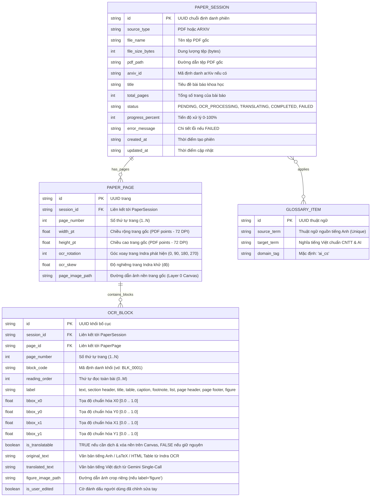

# 05 - Kiến Trúc Dữ Liệu & Mô Hình Lưu Trữ (Data Architecture & Storage Models)

**Tầng tài liệu**: Architecture Layer (Single Source of Truth)  
**Hệ thống**: Paper Translation (Personal & Open-Source Edition)  
**Phiên bản**: 3.1 (Indra OCR Layout Blocks, Normalized BBoxes & 3-Layer Canvas Storage)  
**Ngày cập nhật**: 2026-10-22  
**Trạng thái**: Approved  

---

## 1. Chiến lược Lưu trữ Dữ liệu Tinh gọn (Lightweight Storage Strategy)

Để người dùng cá nhân và cộng đồng mã nguồn mở có thể chạy ngay ứng dụng mà không cần cài đặt máy chủ cơ sở dữ liệu phức tạp, hệ thống áp dụng:
1. **Cơ sở dữ liệu SQLite (WAL Mode):**
   - Lưu trữ toàn bộ dữ liệu phiên làm việc, thông số trang (`paper_pages`) và danh sách khối bố cục (`ocr_blocks`) vào tệp `paper_translation.db`.
   - Bật chế độ **Write-Ahead Logging (WAL)** để hỗ trợ đọc/ghi bất đồng bộ tốc độ cao qua **SQLAlchemy Async (`aiosqlite`)**.
2. **Lưu trữ Tệp Cục bộ (Local File System):**
   - Lưu trữ tệp PDF gốc (`raw_pdfs/`), ảnh nền từng trang (`pages/`), hình ảnh crop riêng (`figures/`) và tệp PDF xuất ra (`exports/`) ngay trong thư mục `backend/storage/`.

---

## 2. Sơ đồ Quan hệ Thực thể (Entity-Relationship Diagram — ERD v3.1)



---

## 3. Đặc tả Chi tiết các Bảng Dữ liệu (Schema Specifications v3.1)

### 3.1. Bảng `paper_sessions`
| Cột | Kiểu dữ liệu | Ràng buộc | Mô tả nghiệp vụ |
|---|---|---|---|
| `id` | `VARCHAR(36)` | `PRIMARY KEY` | UUID phiên làm việc |
| `source_type` | `VARCHAR(20)` | `NOT NULL` | `PDF` hoặc `ARXIV` |
| `file_name` | `VARCHAR(255)` | `NOT NULL` | Tên tệp hiển thị |
| `file_size_bytes` | `INTEGER` | `NOT NULL` | Dung lượng tệp PDF tải lên |
| `pdf_path` | `VARCHAR(500)` | `NOT NULL` | Đường dẫn lưu tệp PDF gốc cục bộ |
| `arxiv_id` | `VARCHAR(50)` | `NULL` | Mã bài báo arXiv (nếu có) |
| `title` | `TEXT` | `NULL` | Tiêu đề trích xuất từ khối `title` trang đầu |
| `total_pages` | `INTEGER` | `DEFAULT 0` | Tổng số trang bài báo |
| `status` | `VARCHAR(30)` | `DEFAULT 'PENDING'` | `PENDING`, `OCR_PROCESSING`, `TRANSLATING`, `COMPLETED`, `FAILED` |
| `progress_percent`| `INTEGER` | `DEFAULT 0` | Tiến trình 0 – 100% |
| `error_message` | `TEXT` | `NULL` | Thông báo lỗi chi tiết nếu gặp sự cố |
| `created_at` | `DATETIME` | `DEFAULT CURRENT_TIMESTAMP` | Thời điểm tạo |
| `updated_at` | `DATETIME` | `DEFAULT CURRENT_TIMESTAMP` | Thời điểm cập nhật |

### 3.2. Bảng `paper_pages`
| Cột | Kiểu dữ liệu | Ràng buộc | Mô tả nghiệp vụ |
|---|---|---|---|
| `id` | `VARCHAR(36)` | `PRIMARY KEY` | UUID của trang |
| `session_id` | `VARCHAR(36)` | `NOT NULL, FOREIGN KEY (paper_sessions.id) ON DELETE CASCADE` | Thuộc phiên bài báo nào |
| `page_number` | `INTEGER` | `NOT NULL` | Thứ tự trang (bắt đầu từ 1) |
| `width_pt` | `FLOAT` | `NOT NULL` | Chiều rộng trang chuẩn PDF (ví dụ: `595.27`) |
| `height_pt` | `FLOAT` | `NOT NULL` | Chiều cao trang chuẩn PDF (ví dụ: `841.89`) |
| `ocr_rotation` | `INTEGER` | `DEFAULT 0` | Góc xoay trang Indra OCR đã xử lý |
| `ocr_skew` | `FLOAT` | `DEFAULT 0.0` | Góc nghiêng Indra OCR đã cân chỉnh |
| `page_image_path` | `VARCHAR(500)` | `NOT NULL` | Đường dẫn ảnh chụp toàn trang độ nét cao (Layer 0) |

**Chỉ mục:**
- `CREATE UNIQUE INDEX idx_pages_session_num ON paper_pages (session_id, page_number ASC);`

### 3.3. Bảng `ocr_blocks`
| Cột | Kiểu dữ liệu | Ràng buộc | Mô tả nghiệp vụ |
|---|---|---|---|
| `id` | `VARCHAR(36)` | `PRIMARY KEY` | UUID khối bố cục |
| `session_id` | `VARCHAR(36)` | `NOT NULL, FOREIGN KEY (paper_sessions.id) ON DELETE CASCADE` | Thuộc phiên bài báo nào |
| `page_id` | `VARCHAR(36)` | `NOT NULL, FOREIGN KEY (paper_pages.id) ON DELETE CASCADE` | Thuộc trang nào |
| `page_number` | `INTEGER` | `NOT NULL` | Số thứ tự trang (1..N) |
| `block_code` | `VARCHAR(20)` | `NOT NULL` | Mã định danh gửi trong prompt Gemini (`BLK_0001`..`BLK_NNNN`) |
| `reading_order` | `INTEGER` | `NOT NULL` | Thứ tự đọc chuẩn do Indra OCR sắp xếp |
| `label` | `VARCHAR(40)` | `NOT NULL` | Nhãn ngữ nghĩa (`text`, `section header`, `title`, `table`, `caption`, `footnote`, `list`, `page header`, `page footer`, `figure`) |
| `bbox_x0` | `FLOAT` | `NOT NULL` | Tọa độ trái chuẩn hóa $\in [0.0, 1.0]$ |
| `bbox_y0` | `FLOAT` | `NOT NULL` | Tọa độ trên chuẩn hóa $\in [0.0, 1.0]$ |
| `bbox_x1` | `FLOAT` | `NOT NULL` | Tọa độ phải chuẩn hóa $\in [0.0, 1.0]$ |
| `bbox_y1` | `FLOAT` | `NOT NULL` | Tọa độ dưới chuẩn hóa $\in [0.0, 1.0]$ |
| `is_translatable` | `BOOLEAN` | `DEFAULT TRUE` | `FALSE` đối với `page header`, `page footer`, `figure`, hoặc mục `References` |
| `original_text` | `TEXT` | `NOT NULL` | Văn bản gốc tiếng Anh (chứa LaTeX `$..$` hoặc `<table>`) |
| `translated_text` | `TEXT` | `NULL` | Bản dịch tiếng Việt hoàn chỉnh từ Gemini |
| `figure_image_path`| `VARCHAR(500)` | `NULL` | Đường dẫn tệp ảnh crop riêng nếu là khối `figure` |
| `is_user_edited` | `BOOLEAN` | `DEFAULT FALSE` | Đánh dấu người dùng đã chỉnh sửa tay trên Canvas |

**Chỉ mục:**
- `CREATE INDEX idx_blocks_session_reading ON ocr_blocks (session_id, reading_order ASC);`
- `CREATE INDEX idx_blocks_page ON ocr_blocks (page_id, reading_order ASC);`

---

## 4. Cấu trúc Thư mục Lưu trữ Tệp Cục bộ (Local File Hierarchy v3.1)

```text
backend/storage/
├── raw_pdfs/
│   └── {session_id}.pdf               # Tệp PDF bài báo gốc
├── pages/
│   └── {session_id}/
│       ├── page_1.png                 # Ảnh kết xuất toàn trang gốc 200 DPI (Layer 0 Canvas)
│       └── page_2.png
├── figures/
│   └── {session_id}/
│       ├── page_1_fig_1.png           # Ảnh sơ đồ/đồ thị được crop riêng theo BBox
│       └── page_3_fig_2.png
└── exports/
    └── {session_id}/
        └── translated.pdf             # Tệp PDF bản dịch hoàn chỉnh
```
