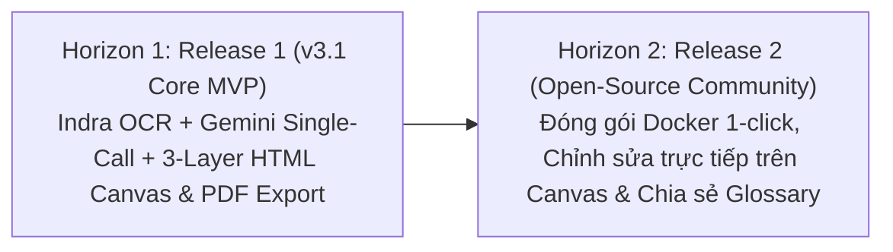

# Product Roadmap — Paper Translation (Personal & Open-Source)

**Tầng tài liệu**: Business Layer  
**Dự án**: Paper Translation  
**Phiên bản**: 3.1 (Indra OCR, Single-Call Gemini & 3-Layer HTML Canvas Edition)  
**Ngày cập nhật**: 2026-10-22  
**Trạng thái**: Approved  

---

## 1. Chiến lược Phân kỳ Lộ trình

---

## 2. Chi tiết các Đợt phát hành

### Horizon 1: Release 1 (v3.1) — Layout-Preserving Core MVP
- **Mục tiêu:** Giải quyết triệt để bài toán dịch bài báo khoa học CNTT & AI giữ nguyên 100% ngữ cảnh toàn bài và diện mạo bố cục 2 cột như bản gốc.
- **Tính năng trọng tâm:**
  - [ ] Tiếp nhận tệp bài báo **PDF** từ máy tính hoặc tải tự động qua mã/liên kết **arXiv**.
  - [ ] Tích hợp **Indra OCR (`indra_ocr` ONNX CPU)** bóc tách bố cục 2 cột, thứ tự đọc, bảng biểu HTML, công thức LaTeX và chuẩn hóa hệ tọa độ `[0.0 .. 1.0]`.
  - [ ] Kết xuất ảnh nền trang gốc độ phân giải cao (Layer 0) và crop riêng các khối hình ảnh (`figure`) qua `PyMuPDF`.
  - [ ] Bộ lọc thông minh giữ nguyên mục `References` + **Dịch toàn văn trong 1 lần gọi duy nhất qua Google Gemini API** (`max_tokens=65536`) kèm cơ chế Auto-Continuation bảo vệ.
  - [ ] Giao diện **3-Layer HTML5 Canvas Viewer**: Tái hiện bài báo bản dịch tiếng Việt giống hệt bản gốc (hỗ trợ Zoom, Pan, bật/tắt đối chiếu tức thì với lớp tiếng Anh gốc).
  - [ ] Xuất và tải về **tệp PDF bản dịch tiếng Việt** giữ nguyên vẹn bố cục gốc chỉ với 1 click.

---

### Horizon 2: Release 2 — Open-Source Community & Advanced Canvas Editing
- **Mục tiêu:** Đóng gói mã nguồn mở tiện lợi và mở rộng khả năng tương tác nâng cao trên Canvas.
- **Tính năng dự kiến:**
  - [ ] Đóng gói Docker Compose chạy 1-click (tích hợp sẵn trọng số ONNX của Indra OCR).
  - [ ] Tính năng nhấp đúp vào bất kỳ khối văn bản nào trên HTML Canvas để chỉnh sửa câu dịch tiếng Việt và tự động vẽ lại khối đó theo thời gian thực.
  - [ ] Lớp Transparent DOM Text Overlay phía trên Canvas giúp người dùng bôi đen và copy văn bản tiếng Việt trực tiếp.
