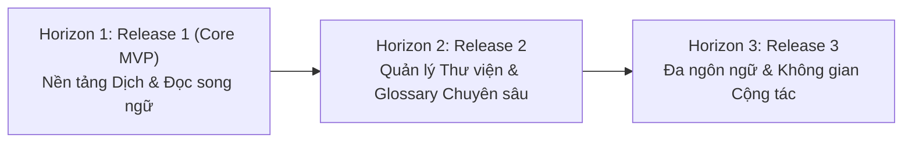

# Product Roadmap — Paper Translation

**Tầng tài liệu**: Business Layer  
**Dự án**: Paper Translation  
**Phiên bản**: 1.0  
**Ngày cập nhật**: 2026-10-05  
**Trạng thái**: Approved  

---

## 1. Chiến lược phân kỳ lộ trình (Phasing Strategy)

Lộ trình phát triển hệ thống Paper Translation được chia thành 3 phân kỳ chính (Horizons), bám sát mục tiêu mang lại giá trị nghiệp vụ nhanh nhất (Time-to-Value) cho cộng đồng nghiên cứu:

---

## 2. Chi tiết các đợt phát hành

### Horizon 1: Release 1 — Core MVP (Nền tảng Dịch thuật & Đọc song ngữ)
- **Mục tiêu:** Cung cấp trải nghiệm trọn vẹn từ lúc đưa bài báo vào đến khi đọc song ngữ và xuất file kết quả.
- **Tính năng trọng tâm:**
  - [x] Tiếp nhận bài báo qua upload tệp PDF cục bộ hoặc nhập URL/ID arXiv.
  - [x] Bóc tách tài liệu và bảo toàn tuyệt đối 100% công thức toán học LaTeX inline và block.
  - [x] Dịch thuật tự động chất lượng cao tiếng Anh sang tiếng Việt bám sát ngữ cảnh học thuật.
  - [x] Áp dụng bộ từ điển thuật ngữ (Glossary) cơ bản trong pipeline dịch.
  - [x] Giao diện đọc song ngữ Dual-pane với cơ chế cuộn đồng bộ (Synchronized Scrolling).
  - [x] Cho phép người dùng chỉnh sửa/duyệt bản dịch trên từng phân đoạn (Segment).
  - [x] Xuất bản dịch ra định dạng Markdown và PDF.

---

### Horizon 2: Release 2 — Quản lý Thư viện cá nhân & Bộ Glossary chuyên sâu
- **Mục tiêu:** Tăng tính gắn kết người dùng, phục vụ nhu cầu lưu trữ và nghiên cứu dài hạn.
- **Tính năng dự kiến:**
  - [ ] Kho lưu trữ bài báo cá nhân (Personal Library & Reading History).
  - [ ] Mở rộng cổng thu thập tài liệu học thuật: Hỗ trợ DOI Resolver, PubMed, Semantic Scholar.
  - [ ] Bộ từ điển thuật ngữ chuyên ngành mở rộng (phân loại theo AI/Data Science, Y sinh, Vật lý, Toán học).
  - [ ] Tính năng đánh dấu (Highlighting) và tạo ghi chú (Annotations) ngay trên giao diện song ngữ.
  - [ ] Chế độ đọc tập trung (Distraction-free Reader Mode) và tùy biến cỡ chữ/theme hiển thị.

---

### Horizon 3: Release 3 — Đa ngôn ngữ mở rộng & Không gian làm việc nhóm
- **Mục tiêu:** Mở rộng quy mô người dùng quốc tế và hỗ trợ các nhóm nghiên cứu (Research Labs).
- **Tính năng dự kiến:**
  - [ ] Hỗ trợ đa ngôn ngữ hai chiều (Tiếng Anh, Tiếng Việt, Tiếng Trung, Tiếng Nhật, Tiếng Pháp, Tiếng Đức).
  - [ ] Không gian làm việc nhóm (Team Workspaces) cho phép chia sẻ thư viện và bộ Glossary chung.
  - [ ] Trợ lý AI tóm tắt bài báo (Executive Summary / Key Findings) và đặt câu hỏi hỏi đáp (Q&A) trên tài liệu.
  - [ ] API tích hợp cho các hệ thống quản lý học thuật và trường viện.
