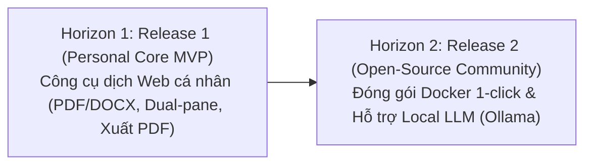

# Product Roadmap — Paper Translation (Personal & Open-Source)

**Tầng tài liệu**: Business Layer  
**Dự án**: Paper Translation  
**Phiên bản**: 2.0 (Scaled Down & Focused)  
**Ngày cập nhật**: 2026-10-05  
**Trạng thái**: Approved  

---

## 1. Chiến lược Phân kỳ Lộ trình

Lộ trình phát triển được tinh giản thành 2 phân kỳ rõ ràng:

---

## 2. Chi tiết các Đợt phát hành

### Horizon 1: Release 1 — Personal Core MVP (Công cụ dịch cá nhân)
- **Mục tiêu:** Đáp ứng trọn vẹn nhu cầu dịch bài báo CNTT & AI của cá nhân trên giao diện Web cục bộ.
- **Tính năng trọng tâm:**
  - [x] Tiếp nhận tệp đầu vào đa định dạng: **Ưu tiên tệp PDF và DOCX** (kèm hỗ trợ dán link arXiv).
  - [x] Bóc tách cấu trúc tài liệu, bảo toàn nguyên vẹn 100% công thức toán LaTeX (`$ ... $`, `$$ ... $$`), hình ảnh và bảng biểu.
  - [x] Dịch thuật ngữ cảnh chuyên sâu ngành Công nghệ thông tin & Trí tuệ nhân tạo (IT/AI/ML/DL).
  - [x] Giao diện Web hiển thị bản dịch song ngữ (Dual-Pane) đối xứng, dễ dàng đối chiếu khi đọc.
  - [x] Tải về **tệp PDF bản dịch tiếng Việt** hoàn chỉnh, giữ nguyên vẹn công thức toán học, bảng biểu và hình ảnh.

---

### Horizon 2: Release 2 — Open-Source Community (Mã nguồn mở cho cộng đồng)
- **Mục tiêu:** Đóng gói ứng dụng để bất kỳ ai trong cộng đồng nghiên cứu cũng có thể cài đặt và sử dụng dễ dàng.
- **Tính năng dự kiến:**
  - [ ] Đóng gói Docker Compose chạy 1-click (One-command setup).
  - [ ] Tích hợp mô hình ngôn ngữ chạy cục bộ (Local LLM via Ollama / vLLM / llama.cpp) giúp người dùng dịch hoàn toàn offline mà không cần API key trả phí.
  - [ ] Bộ từ điển thuật ngữ CNTT & AI chuẩn hóa do cộng đồng cùng đóng góp và mở rộng.
  - [ ] Hỗ trợ xuất thêm định dạng DOCX tiếng Việt và Markdown.
