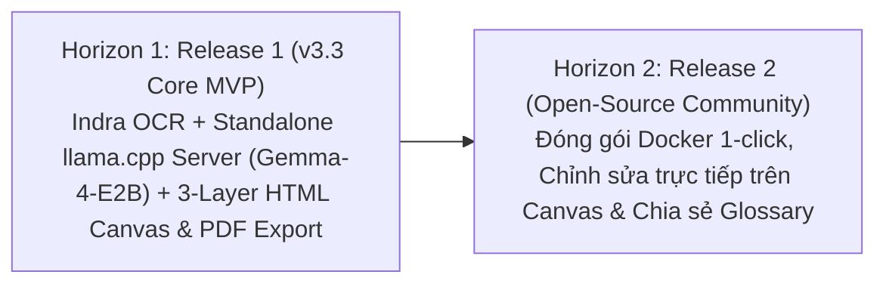

# Product Roadmap — Paper Translation (Personal & Open-Source)

**Tầng tài liệu**: Business Layer  
**Dự án**: Paper Translation  
**Phiên bản**: 3.3 (Indra OCR, Standalone Llama.cpp Server + Gemma-4-E2B & 3-Layer HTML Canvas Edition)  
**Ngày cập nhật**: 2026-10-23  
**Trạng thái**: Approved  

---

## 1. Chiến lược Phân kỳ Lộ trình

---

## 2. Chi tiết các Đợt phát hành

### Horizon 1: Release 1 (v3.3) — Standalone Local-First & Hardware-Optimized Core MVP
- **Mục tiêu:** Giải quyết triệt để bài toán dịch bài báo khoa học CNTT & AI với triết lý **Local-First & Standalone Serving**, tách biệt tiến trình suy luận `llama.cpp` gốc, khai thác sức mạnh mô hình **`gemma-4-E2B-it-qat-UD-Q4_K_XL.gguf`** trên **4 P-cores của Intel Core i5-13500H** trong giới hạn **$\le 8.0\text{ GB}$ RAM**.
- **Tính năng trọng tâm:**
  - [ ] Tiếp nhận tệp bài báo **PDF** từ máy tính hoặc tải tự động qua mã/liên kết **arXiv**.
  - [ ] Tích hợp **Indra OCR (`indra_ocr` ONNX CPU)** bóc tách bố cục 2 cột, thứ tự đọc, bảng biểu HTML, công thức LaTeX và chuẩn hóa hệ tọa độ `[0.0 .. 1.0]`.
  - [ ] **Bộ điều phối tuần tự tài nguyên (Sequential Mutex Execution)**: Giải phóng sạch 100% tài nguyên RAM của Indra OCR trước khi khởi chạy và gọi dịch vụ LLM.
  - [ ] **Dịch vụ Serving Độc Lập (`llama.cpp` Server + `gemma-4-E2B-it-qat-UD-Q4_K_XL.gguf`)**:
    - Cài đặt trực tiếp `llama.cpp` gốc qua `uv/pip`, không gộp chung vào FastAPI mà viết một service riêng quản lý tiến trình `llama.cpp server` và giao tiếp bằng **Python Client qua mạng nội bộ (`127.0.0.1`)**.
    - Tối ưu hóa phần cứng: Sử dụng **4 P-cores trên Intel Core i5-13500H**, cho phép tăng tốc phần cứng, giới hạn trần cứng **RAM $\le 8.0\text{ GB}$**.
    - Tối ưu ngữ cảnh **16K tokens (`n_ctx=16384`)** (hỗ trợ chế độ 8K), đóng gói mỗi lượt gọi đạt **2,000 – 2,500 từ tiếng Anh** (gồm System Prompt + Text bài báo) và đảm bảo đầu ra tiếng Việt dư dả gấp **2.0 – 2.5 lần** không bị tràn context.
  - [ ] **Chỉ báo động cơ trên UI**: Hiển thị rõ ràng huy hiệu trạng thái đang xử lý bằng `Local LLM: Gemma-4-E2B` hay `Cloud API`.
  - [ ] Kết xuất ảnh nền trang gốc độ phân giải cao (Layer 0) và crop riêng các khối hình ảnh (`figure`) qua `PyMuPDF`.
  - [ ] Giao diện **3-Layer HTML5 Canvas Viewer**: Tái hiện bài báo bản dịch tiếng Việt giống hệt bản gốc (hỗ trợ Zoom, Pan, bật/tắt đối chiếu tức thì với lớp tiếng Anh gốc).
  - [ ] Xuất và tải về **tệp PDF bản dịch tiếng Việt** giữ nguyên vẹn bố cục gốc chỉ với 1 click.

---

### Horizon 2: Release 2 — Open-Source Community & Advanced Canvas Editing
- **Mục tiêu:** Đóng gói mã nguồn mở tiện lợi và mở rộng khả năng tương tác nâng cao trên Canvas.
- **Tính năng dự kiến:**
  - [ ] Đóng gói Docker Compose chạy 1-click (tích hợp sẵn trọng số ONNX của Indra OCR và `llama.cpp` server).
  - [ ] Tính năng nhấp đúp vào bất kỳ khối văn bản nào trên HTML Canvas để chỉnh sửa câu dịch tiếng Việt và tự động vẽ lại khối đó theo thời gian thực.
  - [ ] Lớp Transparent DOM Text Overlay phía trên Canvas giúp người dùng bôi đen và copy văn bản tiếng Việt trực tiếp.
