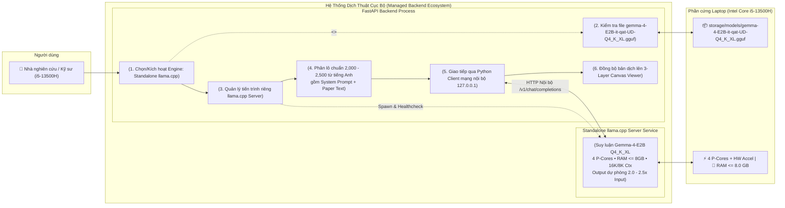
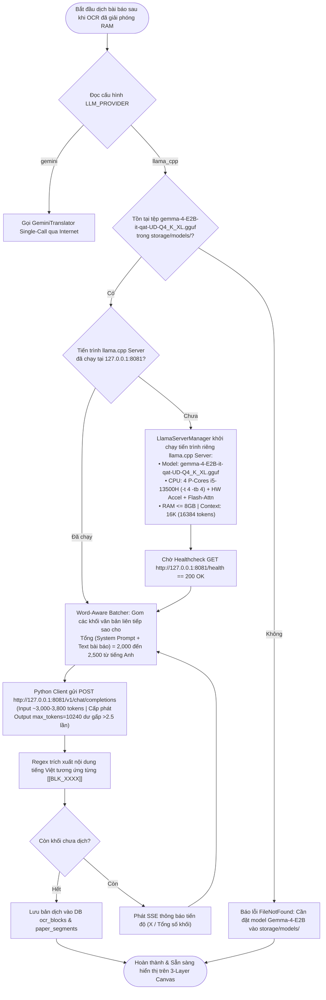

# Product Requirements Document (PRD): Standalone Local LLM Serving (`llama.cpp` Server & `Gemma-4-E2B`)

**Tầng tài liệu**: Implementation Layer  
**Release**: release-1 (Personal Core MVP — Standalone Local LLM Serving)  
**Phiên bản**: 2.0 (Standalone `llama.cpp` Server, `gemma-4-E2B-it-qat-UD-Q4_K_XL.gguf`, 4 P-Cores i5-13500H, 8GB RAM Limit & 2000-2500 Words Batching)  
**Ngày cập nhật**: 2026-10-23  
**Tác giả**: Senior IT-BA & Product Owner  
**Trạng thái**: Approved  
**Chất lượng yêu cầu**: 98/100  

---

## 1. Mục tiêu Tính Năng & Bối Cảnh Nghiệp Vụ (Business Context)

### 1.1. Mục tiêu tính năng (Feature Goals)
- **Tham chiếu Business Layer**: Bám sát [docs/business/brd.md](file:///E:/MyProject/paper-translation/docs/business/brd.md) và lộ trình [docs/business/roadmap.md](file:///E:/MyProject/paper-translation/docs/business/roadmap.md).
- **Bài toán giải quyết**:
  1. **Tách Biệt Tiến Trình Serving (Standalone `llama.cpp` Server Architecture)**: Thay vì sử dụng `llama-cpp-python` gộp chung vào bên trong tiến trình FastAPI (dễ gây nghẽn GIL và hạn chế hiệu năng), hệ thống cài đặt trực tiếp thư viện/công cụ `llama.cpp` gốc qua `uv/pip`, xây dựng một **Service riêng quản lý tiến trình `llama.cpp server`** chạy độc lập và sử dụng **Python Client giao tiếp qua mạng nội bộ (`127.0.0.1`)**.
  2. **Nâng Cấp Chất Lượng Dịch Với Mô Hình `gemma-4-E2B-it-qat-UD-Q4_K_XL.gguf`**: Chuyển sang sử dụng mô hình `gemma-4-E2B-it-qat-UD-Q4_K_XL.gguf` (~2.62 GB) tại `backend/storage/models/` để đạt chất lượng dịch thuật ngữ học thuật tiếng Việt tự nhiên, chuẩn xác vượt trội.
  3. **Tối Ưu Phần Cứng Laptop Intel Core i5-13500H & Trần 8GB RAM**: Cho phép sử dụng tăng tốc phần cứng, cấu hình `llama.cpp` khai thác đúng **4 P-cores (Performance Cores)** trên chip **Intel Core i5-13500H** và giới hạn bộ nhớ **RAM $\le 8.0\text{ GB}$**.
  4. **Đảm Bảo Ngân Sách Từ (2,000 – 2,500 Từ Tiếng Anh) & Chống Tràn Ngữ Cảnh Tiếng Việt**: Tối ưu cửa sổ ngữ cảnh **16K tokens (`n_ctx=16384`)** (hoặc 8K tùy chọn) sao cho tốc độ xử lý đạt mức cao nhất nhưng đảm bảo mỗi lượt gọi bao gồm **System Prompt + Text của bài báo** nằm trong **2,000 đến 2,500 từ tiếng Anh**, và dành không gian Output thật dư dả để văn bản tiếng Việt sinh ra (có số từ/token gấp **2.0 – 2.5 lần** tiếng Anh) **không bao giờ bị tràn context**.

### 1.2. Chỉ số thành công (Success Metrics & KPIs)
| Chỉ số (KPI) | Cấu hình cũ (v1.0 In-Process) | Mục tiêu tính năng mới (v2.0 Standalone) | Cách đo lường |
|---|---|---|---|
| **Kiến trúc thực thi** | Gộp chung trong FastAPI (`llama-cpp-python`) | Tiến trình `llama.cpp server` riêng + Python Client nội bộ | Kiểm tra Process Tree & kết nối `127.0.0.1:8081` |
| **Mô hình sử dụng** | `Qwen3-1.7B-Q4_K_M.gguf` | **`gemma-4-E2B-it-qat-UD-Q4_K_XL.gguf`** | Kiểm tra `/api/v1/system/engine-status` |
| **Cấu hình CPU & Phần cứng** | `threads = auto` (lẫn E-cores) | **4 P-cores trên Intel Core i5-13500H** (`-t 4 -tb 4`) + HW Accel | Kiểm tra tham số khởi chạy `llama.cpp` server |
| **Giới hạn bộ nhớ RAM** | Trần 4GB (hạn hẹp cho 16K ctx) | **Trần $\le 8.0\text{ GB}$ RAM** (Thực tế ~3.8–4.5 GB ở 16K ctx) | Resource Monitor / Task Manager |
| **Quy mô Input / Output mỗi Batch** | ~1,500 tokens (chia quá nhỏ) | Input **2,000 – 2,500 từ EN**; Output dự phòng **gấp 2.0 – 2.5x** (0% tràn context) | Kiểm tra Batch Word Counter & Log suy luận |

---

## 2. Đối tượng sử dụng (User Personas)

### Persona 1: Nhà nghiên cứu / Kỹ sư CNTT & AI trên Laptop Intel Core i5-13500H
- **Vai trò**: Chủ sở hữu dự án sử dụng laptop trang bị CPU **Intel Core i5-13500H** (4 P-cores + 8 E-cores), cần dịch nhanh các bài báo khoa học dài (10–25 trang) hoàn toàn ngoại tuyến.
- **Mục tiêu**: Tận dụng tối đa tốc độ của 4 nhân P-cores và tăng tốc phần cứng trong giới hạn 8GB RAM, gửi được các đoạn văn bản lớn (2,000–2,500 từ tiếng Anh mỗi lượt) để mô hình hiểu trọn vẹn mạch văn học thuật mà không bao giờ bị đứt câu tiếng Việt do tràn context.

---

## 3. Ranh giới hệ thống & Sơ đồ phạm vi (Scope & System Boundary)

### 3.1. Sơ đồ Use Case (Use Case Diagram)

### 3.2. Phạm vi chi tiết (Scope Definition)
- **In-Scope (Phạm vi thực hiện)**:
  - Sử dụng `uv/pip install` trực tiếp thư viện/gói thực thi `llama.cpp` gốc trong môi trường ảo `.venv` của dự án (loại bỏ sự phụ thuộc vào cách chạy in-process của `llama-cpp-python` bên trong FastAPI).
  - Xây dựng service quản lý tiến trình độc lập (`LlamaServerManager`) để khởi chạy, giám sát và dừng `llama.cpp server` chạy model `gemma-4-E2B-it-qat-UD-Q4_K_XL.gguf`.
  - Xây dựng **Python Client (`LlamaInternalClient`)** trong Backend để giao tiếp với `llama.cpp server` qua mạng nội bộ (`http://127.0.0.1:8081/v1/chat/completions`).
  - Cấu hình phần cứng chuyên biệt cho laptop **Intel Core i5-13500H**: Sử dụng **4 P-cores (`threads=4`, `threads_batch=4`)**, bật tăng tốc phần cứng (`flash_attn`, GPU/iGPU layers nếu có), kiểm soát bộ nhớ **RAM $\le 8.0\text{ GB}$**.
  - Xây dựng bộ phân lô theo số từ (**Word-Budget Batcher**): Đảm bảo mỗi lần gọi có tổng **System Prompt + Text bài báo** nằm trong khoảng **2,000 – 2,500 từ tiếng Anh** (~3,000 – 3,800 tokens), và cấu hình cửa sổ ngữ cảnh **16K tokens (`n_ctx=16384`, `max_tokens=10240`)** (hỗ trợ tùy chọn 8K) để đầu ra tiếng Việt (gấp **2.0 – 2.5 lần** tiếng Anh) hoàn toàn dư dả, không bị tràn context.
- **Out-of-Scope (Không thực hiện)**:
  - Không chạy gộp chung mô hình LLM bên trong tiến trình bộ nhớ của FastAPI.
  - Không mở cổng `llama.cpp server` ra mạng công cộng bên ngoài (chỉ bind `127.0.0.1` nội bộ).

---

## 4. Quy trình nghiệp vụ chi tiết (Core Workflows)

---

## 5. Yêu cầu chức năng & Quy tắc nghiệp vụ (Functional & Business Rules)

| Mã yêu cầu | Tên chức năng | Mô tả nghiệp vụ | Quy tắc nghiệp vụ & Kỹ thuật (Business & Technical Rules) | Ưu tiên |
|---|---|---|---|---|
| **FR-07.1** | Dịch Vụ Quản Lý Tiến Trình `llama.cpp` Server Riêng (`LlamaServerManager`) | Quản lý vòng đời tiến trình `llama.cpp server` độc lập dưới sự điều khiển của Backend | - Cài đặt trực tiếp thư viện/thực thi `llama.cpp` gốc qua `uv/pip` trong `.venv`. - Không chạy gộp chung trong FastAPI. - Tự động tìm mô hình `gemma-4-E2B-it-qat-UD-Q4_K_XL.gguf` tại `backend/storage/models/`. - Cung cấp cơ chế khởi động (`start_server()`), kiểm tra sức khỏe (`health_check()`) và tắt tiến trình thu hồi sạch RAM (`stop_server()`). | P0 (Must) |
| **FR-07.2** | Tối Ưu Phần Cứng Intel Core i5-13500H (4 P-Cores) & Trần 8GB RAM | Cấu hình tiến trình `llama.cpp server` khai thác tối đa phần cứng laptop hiện tại | - Cấu hình cứng `--threads 4` và `--threads-batch 4` để sử dụng đúng **4 P-cores** trên Intel Core i5-13500H. - Cho phép bật tăng tốc phần cứng (`--flash-attn`, GPU/iGPU offloading, KV cache quantization `q8_0`). - Giới hạn tổng mức tiêu thụ bộ nhớ của server **$\le 8.0\text{ GB}$ RAM**. | P0 (Must) |
| **FR-07.3** | Bộ Phân Lô Theo Số Từ (2,000–2,500 Từ EN) & Dự Phòng Output 2.0–2.5x | Đóng gói văn bản chuẩn xác theo số từ tiếng Anh và bảo vệ đầu ra tiếng Việt không tràn ngữ cảnh | - Mỗi batch đầu vào bao gồm **System Prompt + Text của bài báo** phải nằm trong khoảng **2,000 đến 2,500 từ tiếng Anh** (~3,000 – 3,800 tokens). - Cấu hình ngữ cảnh chuẩn **16K tokens (`n_ctx=16384`)** (hỗ trợ tùy chọn 8K `n_ctx=8192`) và `max_tokens=10240` để văn bản tiếng Việt sinh ra (nhiều hơn gấp **2.0 – 2.5 lần** từ/token so với tiếng Anh) hoàn toàn dư dả không gian, tuyệt đối không bị tràn context. | P0 (Must) |
| **FR-07.4** | Giao Tiếp Qua Python Client Mạng Nội Bộ & Bảo Toàn Mã Khối | Kết nối từ FastAPI sang `llama.cpp server` qua mạng Loopback và bóc tách kết quả | - Sử dụng Python Async HTTP Client (`httpx.AsyncClient`) gọi tới `http://127.0.0.1:8081/v1/chat/completions`. - Bảo toàn 100% mã định danh `[[BLK_XXXX]]`, công thức toán LaTeX `$..$` và bảng HTML `<table>`. - Nếu thiếu mã khối nào trong batch, tự động gọi bù riêng lẻ qua kết nối nội bộ. | P0 (Must) |
| **FR-07.5** | Tích Hợp Vào Translator Router & Hiển Thị Trạng Thái UI | Cho phép chuyển đổi mượt mà giữa Standalone Llama.cpp và Cloud Gemini | - Đồng bộ trực tiếp vào bảng SQLite `ocr_blocks` và `paper_segments` phục vụ 3-Layer Canvas Viewer. - Hiển thị huy hiệu trên UI: 🟢 `Local LLM: Gemma-4-E2B (16K Ctx • 4 P-Cores)`. | P0 (Must) |

---

## 6. Rào chắn Kiến trúc (Architecture Guardrails)

> ⛔ **Bắt buộc tuân thủ Single Source of Truth**:

1. **Rào chắn Tách Biệt Tiến Trình (Process Decoupling Invariant):**
   - Nghiêm cấm import và khởi tạo mô hình LLM chạy chung trong không gian bộ nhớ của worker FastAPI. Mọi tác vụ suy luận cục bộ phải đi qua tiến trình `llama.cpp server` độc lập và giao tiếp bằng Python Client qua mạng nội bộ (`127.0.0.1`).
2. **Rào chắn Phần Cứng & Ngân Sách Context (Hardware & Context Invariant):**
   - Tiến trình `llama.cpp server` phải được cấu hình đúng **4 P-cores (`threads=4`)** cho Intel Core i5-13500H và không vượt quá **8.0 GB RAM**.
   - Với lô đầu vào **2,000 – 2,500 từ tiếng Anh**, cửa sổ ngữ cảnh mặc định phải là **16K (`16384` tokens)** để đảm bảo đầu ra tiếng Việt (gấp 2.0 – 2.5 lần) không bao giờ chạm trần context.
3. **Rào chắn Độc Lập Môi Trường (Environment Isolation):**
   - Mọi cài đặt bằng `uv/pip` phải nằm gói gọn trong môi trường ảo `.venv` của dự án theo đúng quy tắc tại `AGENTS.md`.

---

## 7. Quản lý Câu hỏi mở (Open Questions Log)

| Mã OQ | Câu hỏi nghiệp vụ cần làm rõ | Bên phụ trách | Trạng thái | Kết quả chốt |
|---|---|---|---|---|
| `OQ-01` | Chạy Llama.cpp dưới dạng In-Process hay Standalone Server? | Product Owner / User | `[x] Resolved` | Chuyển sang xây dựng **Serving riêng lẻ**: Backend quản lý một service riêng chạy `llama.cpp server` gốc và dùng **Python Client giao tiếp qua mạng nội bộ (`127.0.0.1`)**. |
| `OQ-02` | Sử dụng mô hình GGUF nào làm mặc định? | Product Owner / User | `[x] Resolved` | Chuyển sang sử dụng **`gemma-4-E2B-it-qat-UD-Q4_K_XL.gguf`**. |
| `OQ-03` | Cấu hình phần cứng cho CPU Intel Core i5-13500H và giới hạn RAM? | Product Owner / User | `[x] Resolved` | Cho phép tăng tốc phần cứng, cấu hình sử dụng **4 P-cores** trên Intel Core i5-13500H, giới hạn **RAM $\le 8.0\text{ GB}$**. |
| `OQ-04` | Quy mô từ đầu vào (Input) và dự phòng đầu ra tiếng Việt (Output) trên ngữ cảnh 8K/16K? | Product Owner / User | `[x] Resolved` | Input (System Prompt + Text bài báo) đạt **2,000 – 2,500 từ tiếng Anh**; tối ưu ngữ cảnh **16K tokens** (hỗ trợ 8K) để Output tiếng Việt (nhiều hơn **2.0 – 2.5 lần** tiếng Anh) thật dư dả, không bị tràn context. |
