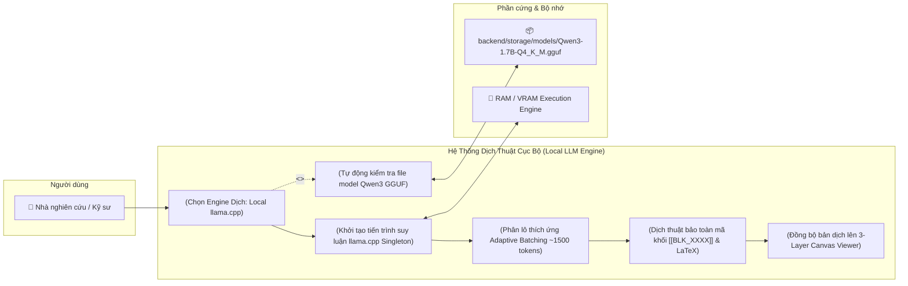
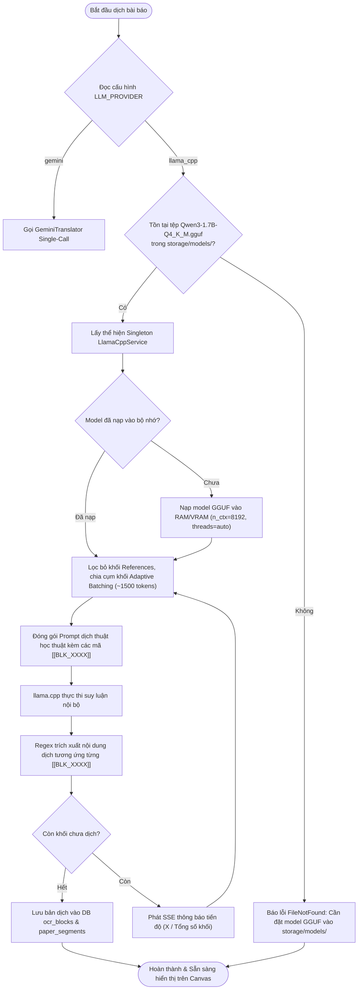

# Product Requirements Document (PRD): Local LLM Translation Engine (`llama.cpp` & `Qwen3`)

**Tầng tài liệu**: Implementation Layer  
**Release**: release-1 (Personal Core MVP — Local LLM Extension)  
**Phiên bản**: 1.0  
**Ngày tạo**: 2026-10-23  
**Tác giả**: Senior IT-BA & Product Owner  
**Trạng thái**: Approved  
**Chất lượng yêu cầu**: 95/100  

---

## 1. Mục tiêu Tính Năng & Bối Cảnh Nghiệp Vụ (Business Context)

### 1.1. Mục tiêu tính năng (Feature Goals)
- **Tham chiếu Business Layer**: Bám sát [docs/business/brd.md](file:///E:/MyProject/paper-translation/docs/business/brd.md) và lộ trình [docs/business/roadmap.md](file:///E:/MyProject/paper-translation/docs/business/roadmap.md).
- **Bài toán giải quyết**:
  1. **Dịch Thuật Ngoại Tuyến (100% Offline & Zero Cost)**: Cho phép các nhà nghiên cứu dịch bài báo khoa học mà không cần kết nối Internet, không phụ thuộc vào Google Gemini hay bất kỳ nhà cung cấp Cloud LLM nào, loại bỏ hoàn toàn chi phí token.
  2. **Bảo Mật & Riêng Tư Tuyệt Đối**: Toàn bộ nội dung bài báo khoa học (kể cả các bản thảo chưa công bố) được suy luận trực tiếp trên phần cứng máy tính cục bộ, không gửi bất kỳ byte dữ liệu nào ra mạng Internet.
  3. **Tận Dụng Trọng Số Tải Sẵn**: Khai thác trực tiếp mô hình lượng hóa tối ưu `Qwen3-1.7B-Q4_K_M.gguf` đã có sẵn tại thư mục `backend/storage/models/`.

### 1.2. Chỉ số thành công (Success Metrics & KPIs)
| Chỉ số (KPI) | Baseline hiện tại (Cloud Gemini) | Mục tiêu tính năng Local LLM | Cách đo lường |
|---|---|---|---|
| **Sự phụ thuộc mạng (Network Dependency)** | Cần Internet & API Key hợp lệ | 0% (Hoạt động hoàn toàn Offline) | Kiểm tra ngắt kết nối mạng vẫn dịch thành công |
| **Bảo mật dữ liệu (Data Privacy)** | Gửi gói tin qua HTTPS tới Google Cloud | 100% Cục bộ (Local Memory & CPU/GPU) | Network packet inspection / Không có outbound request |
| **Độ chính xác nhãn cấu trúc** | 99% giữ nguyên `[[BLK_XXXX]]` & LaTeX | $\ge 98\%$ bảo toàn mã khối và LaTeX | Unit & Integration Test Regex validator |
| **Tốc độ suy luận (Throughput)** | ~15-25s toàn bài qua Cloud API | $\ge 15 - 30$ tokens/giây trên phần cứng cá nhân | Benchmark throughput qua `llama.cpp` logger |

---

## 2. Đối tượng sử dụng (User Personas)

### Persona 1: Nhà nghiên cứu khoa học / Kỹ sư R&D
- **Vai trò**: Độc giả dịch tài liệu khoa học bảo mật cao hoặc làm việc trong môi trường mạng nội bộ cô lập (Air-gapped network).
- **Mục tiêu**: Dịch nhanh toàn bộ bài báo tiếng Anh sang tiếng Việt với độ chính xác thuật ngữ cao, giữ nguyên bố cục và công thức toán mà không để lộ dữ liệu ra bên ngoài.
- **Rào cản trước đây**: Bắt buộc phải có Google API Key hoặc trả phí token hàng tháng.

### Persona 2: Người dùng cá nhân có máy tính cấu hình vừa phải
- **Vai trò**: Người dùng muốn trải nghiệm dịch bài báo miễn phí, cấu hình máy tính tầm trung (8GB–16GB RAM, CPU đa nhân hoặc GPU phổ thông).
- **Mục tiêu**: Chạy được mô hình dịch thuật mượt mà, không bị tràn RAM, không treo máy.

---

## 3. Ranh giới hệ thống & Sơ đồ phạm vi (Scope & System Boundary)

### 3.1. Sơ đồ Use Case (Use Case Diagram)

### 3.2. Phạm vi chi tiết (Scope Definition)
- **In-Scope (Phạm vi thực hiện)**:
  - Tích hợp dịch vụ chạy mô hình LLM cục bộ bằng thư viện `llama-cpp-python` (hoặc wrapper `llama.cpp` tương thích chuẩn).
  - Tự động nạp mô hình `Qwen3-1.7B-Q4_K_M.gguf` từ đường dẫn cấu hình `backend/storage/models/`.
  - Cấu hình tham số suy luận tối ưu: `n_ctx=8192` (hoặc 4096 tùy dung lượng RAM), `n_threads=auto`, `temperature=0.2`.
  - Tự động đóng gói và dịch thuật theo chiến lược **Adaptive Batching** (cụm 6–8 khối văn bản liên tiếp kèm mã `[[BLK_XXXX]]`) để phù hợp với ngữ cảnh của mô hình 1.7B.
  - Xử lý mượt mà việc bảo tồn mã khối `[[BLK_XXXX]]`, công thức toán `$..$`, bảng biểu `<table>`.
  - Hỗ trợ chuyển đổi linh hoạt giữa `gemini` và `llama_cpp` thông qua cấu hình `LLM_PROVIDER` hoặc thiết lập ứng dụng.
- **Out-of-Scope (Không thực hiện)**:
  - Tự động huấn luyện (Fine-tuning) hoặc chuyển đổi lượng hóa (Quantization) các định dạng mô hình mới.
  - Hỗ trợ phân tán mô hình trên cụm nhiều máy tính (Distributed inference cluster).

---

## 4. Quy trình nghiệp vụ chi tiết (Core Workflows)

---

## 5. Yêu cầu chức năng & Quy tắc nghiệp vụ (Functional & Business Rules)

| Mã yêu cầu | Tên chức năng | Mô tả nghiệp vụ | Quy tắc nghiệp vụ & Kỹ thuật (Business & Technical Rules) | Ưu tiên |
|---|---|---|---|---|
| **FR-07.1** | Quản lý Mô hình Cục bộ (`Model Lifecycle Manager`) | Tự động phát hiện và quản lý vòng đời của mô hình GGUF trong thư mục `storage/models/` | - Mặc định tìm tệp `Qwen3-1.7B-Q4_K_M.gguf`. - Nếu không tìm thấy, trả về thông báo lỗi rõ ràng hướng dẫn vị trí đặt model. - Singleton pattern: Chỉ nạp model 1 lần duy nhất trong suốt vòng đời tiến trình, tránh rò rỉ bộ nhớ. | P0 (Must) |
| **FR-07.2** | Bộ Suy Luận Llama.cpp Engine | Thực thi sinh văn bản cục bộ bằng `llama-cpp-python` | - Tham số khởi tạo: `n_ctx=8192`, `n_threads = os.cpu_count() // 2` (hoặc cấu hình), `n_gpu_layers = -1` (nếu có CUDA) hoặc `0` (CPU fallback). - Tham số sinh: `temperature=0.2`, `top_p=0.9`, `max_tokens=2048` mỗi batch. | P0 (Must) |
| **FR-07.3** | Phân Lô Thích Ứng (Adaptive Batching Engine) | Chia nhỏ danh sách khối văn bản cần dịch thành các lô an toàn với ngữ cảnh model | - Mỗi batch gồm 6–8 khối văn bản liên tiếp (hoặc $\le 1,500$ tokens). - Tự động gắn tag định danh `[[BLK_XXXX]]` trước mỗi khối và yêu cầu model giữ nguyên tag ở đầu ra. - Bỏ qua mục `References` và `figure` tương tự pipeline của Gemini. | P0 (Must) |
| **FR-07.4** | Bóc Tách & Tự Động Khôi Phục Mã Khối | Trích xuất văn bản dịch tiếng Việt tương ứng từng `[[BLK_XXXX]]` | - Sử dụng Regex `\[\[BLK_(\d+)\]\]\s*(.*?)(?=\[\[BLK_\d+\]\]|$)` với cờ `DOTALL`. - Nếu model lỡ nuốt mã khối nào trong batch, kích hoạt fallback dịch đơn lẻ cho riêng khối đó để không làm gián đoạn toàn bài. | P0 (Must) |
| **FR-07.5** | Tích Hợp Vào Translator Router | Cho phép người dùng chuyển đổi mượt mà giữa Gemini và Llama.cpp | - Thống nhất giao diện qua lớp cơ sở `BaseTranslator` hoặc `TranslationService`. - Đồng bộ trực tiếp vào bảng SQLite `ocr_blocks` và `paper_segments` phục vụ 3-Layer Canvas Viewer. | P0 (Must) |

---

## 6. Rào chắn Kiến trúc (Architecture Guardrails)

> ⛔ **Bắt buộc tuân thủ Single Source of Truth**:

1. **Rào chắn Giao Diện Thống Nhất (Architecture 06 & 08):** Dịch vụ cục bộ phải tuân thủ chặt chẽ cùng khuôn mẫu đầu vào/đầu ra với `GeminiTranslator` (nhận danh sách khối layout, trả về từ điển `{block_id: translated_text}`), đảm bảo tầng Presentation (3-Layer HTML Canvas Viewer) và tầng Dữ liệu (SQLite) hoàn toàn không bị ảnh hưởng.
2. **Rào chắn Quản Lý Tài Nguyên (Resource Management):**
   - Tuyệt đối không khởi tạo mới đối tượng `Llama` trên mỗi request gây nghẽn RAM và tràn bộ nhớ.
   - Cung cấp hàm giải phóng `unload_model()` tường minh khi ứng dụng tắt (`lifespan shutdown`).
3. **Rào chắn Độc Lập Môi Trường (Environment Isolation):**
   - Mọi cài đặt gói phụ thuộc (`llama-cpp-python`) phải thực thi trong môi trường ảo `.venv` cô lập theo đúng quy tắc tại `AGENTS.md`.

---

## 7. Quản lý Câu hỏi mở (Open Questions Log)

| Mã OQ | Câu hỏi nghiệp vụ cần làm rõ | Bên phụ trách | Trạng thái | Kết quả chốt |
|---|---|---|---|---|
| `OQ-01` | Chạy Llama.cpp dưới dạng In-Process Python Service hay Standalone Server process? | Solution Architect / Dev | `[x] Resolved` | Triển khai **In-process Service** qua `llama-cpp-python` để tích hợp mượt mà vào FastAPI, tự động kiểm tra model và quản lý tài nguyên. |
| `OQ-02` | Kích thước ngữ cảnh (Context Window) tối ưu cho Qwen3-1.7B? | AI Engineer / BA | `[x] Resolved` | Cấu hình `n_ctx=8192`, chạy qua **Adaptive Batching** (6–8 khối / batch) để đảm bảo không bị hallucination hoặc suy giảm chất lượng dịch. |
| `OQ-03` | Xử lý tăng tốc phần cứng (Hardware Acceleration)? | DevOps / Backend | `[x] Resolved` | Tự động phát hiện GPU (CUDA): nếu có hỗ trợ thì đặt `n_gpu_layers=-1`, nếu không tự động fallback sang CPU đa luồng (`n_gpu_layers=0`). |

---

## 8. Kế hoạch bàn giao & Bước tiếp theo

1. **Đồng bộ Sổ cái Backlog:** Chuyển giao sang skill `user-story-ac-writer` để bóc tách tính năng thành các User Story chi tiết:
   - `US-007: Khởi tạo LlamaCppService & Quản lý vòng đời mô hình Qwen3 GGUF`.
   - `US-008: Cơ chế Adaptive Batching & Dịch thuật bảo toàn mã khối qua Qwen3`.
2. **Triển khai kỹ thuật (Technical Implementation):**
   - Bổ sung cấu hình `LLM_MODEL_PATH` trong `backend/app/core/config.py`.
   - Xây dựng service `backend/app/services/translation/llama_service.py`.
   - Tích hợp vào `backend/app/services/translation/translation_service.py`.
