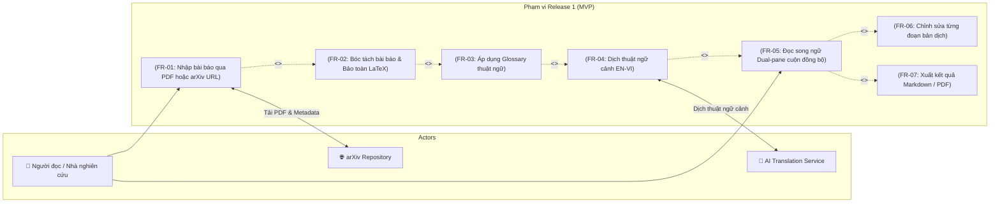
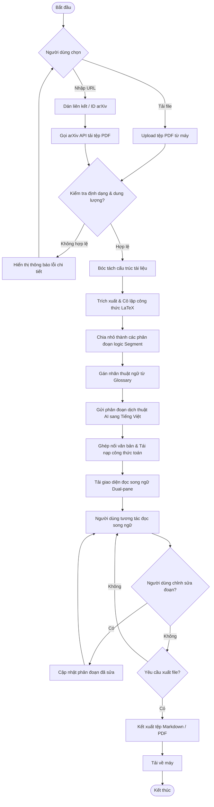

# Product Requirements Document (PRD): Release 1 (Core MVP)

**Tầng tài liệu**: Implementation Layer  
**Release**: release-1 (Core MVP)  
**Phiên bản**: 1.0  
**Ngày tạo**: 2026-10-05  
**Tác giả**: Senior IT-BA & PO  
**Trạng thái**: Approved  
**Chất lượng yêu cầu**: 95/100  

---

## 1. Mục tiêu Đợt Phát hành & Bối cảnh Kinh doanh (Business Context)

### 1.1. Mục tiêu đợt phát hành (Release Goals)
- **Tham chiếu Business Layer:** Hiện thực hóa Horizon 1 trong lộ trình [docs/business/roadmap.md](file:///E:/MyProject/paper-translation/docs/business/roadmap.md) bám sát tầm nhìn [docs/business/brd.md](file:///E:/MyProject/paper-translation/docs/business/brd.md).
- **Bài toán giải quyết trong Release 1:** Cung cấp giải pháp trọn vẹn cho phép các nhà nghiên cứu, kỹ sư và sinh viên dịch nhanh các bài báo khoa học tiếng Anh sang tiếng Việt với 3 giá trị cốt lõi:
  1. Bảo toàn nguyên vẹn 100% các công thức toán LaTeX/MathJax, bảng biểu và hình ảnh.
  2. Dịch thuật chuẩn xác thuật ngữ chuyên ngành nhờ tích hợp từ điển Glossary.
  3. Trải nghiệm đọc song ngữ Dual-pane cuộn đồng bộ trực quan, cho phép chỉnh sửa và xuất file.

### 1.2. Chỉ số thành công (Success Metrics & KPIs)
| Chỉ số (KPI) | Baseline hiện tại | Mục tiêu Release 1 (MVP) | Cách đo lường |
|---|---|---|---|
| Tỷ lệ bảo toàn công thức toán | 0% (các tool phổ thông bị lỗi font/cú pháp) | 100% công thức LaTeX hợp lệ cú pháp | Kiểm tra tự động qua MathJax parser |
| Tỷ lệ tuân thủ Glossary | Không có | $\ge 95\%$ thuật ngữ trong bài khớp Glossary | Đối soát tự động giữa bản dịch và Glossary |
| Thời gian dịch 1 bài báo (20 trang) | ~15-30 phút (thủ công) | $< 60$ giây | Log hệ thống đo thời gian pipeline xử lý |
| Tỷ lệ lỗi trong khâu Ingestion PDF/arXiv | N/A | $< 2\%$ trên tổng số tệp hợp lệ | Log giám sát hệ thống |

---

## 2. Đối tượng sử dụng trong Release này (User Personas)

### Persona 1: Nhà nghiên cứu khoa học / Kỹ sư R&D
- **Vai trò:** Người dùng cuối chính (Primary User).
- **Mục tiêu trong Release 1:** Tải tệp PDF từ máy hoặc dán link arXiv để nhận ngay bản dịch tiếng Việt song song với bản gốc tiếng Anh, có thể đọc lướt, kiểm tra công thức và lưu file kết quả.
- **Rào cản:** Các công cụ hiện tại dịch làm vỡ bảng biểu, mất công thức toán và dịch sai thuật ngữ công nghệ.

### Persona 2: Sinh viên chuyên ngành kỹ thuật / Người học
- **Vai trò:** Độc giả học thuật (Academic Reader).
- **Mục tiêu trong Release 1:** Đọc hiểu tài liệu bài báo chuyên ngành tiếng Anh với bản dịch tiếng Việt mượt mà, dễ hiểu, vừa đọc vừa tra cứu đối chiếu.

---

## 3. Ranh giới hệ thống & Sơ đồ phạm vi (Scope & System Boundary)

> **Mục đích:** Khóa phạm vi chức năng bàn giao trong Release 1. Đồng bộ trực tiếp với [docs/architecture/01-system-context.md](file:///E:/MyProject/paper-translation/docs/architecture/01-system-context.md).

### 3.1. Sơ đồ Use Case Release 1

### 3.2. Phạm vi chi tiết (Scope Definition)
- **In-Scope (Cam kết bàn giao trong Release 1):**
  - Tiếp nhận tệp PDF (tối đa 30MB / 50 trang) hoặc liên kết arXiv (URL dạng `arxiv.org/abs/...` hoặc `arxiv.org/pdf/...`).
  - Phân tích bóc tách cấu trúc bài báo: Tiêu đề, Tác giả, Abstract, Các Heading, Nội dung đoạn, Công thức toán học (inline `$ $` và block `$$ $$`), Bảng biểu và Hình ảnh.
  - Cô lập công thức toán học trước khi dịch và khôi phục nguyên vẹn sau khi dịch.
  - Quản lý bộ từ điển Glossary cơ bản (thêm/sửa/xóa cặp thuật ngữ Source-Target).
  - Pipeline dịch thuật AI từ Tiếng Anh sang Tiếng Việt có gán ghép thuật ngữ.
  - Giao diện đọc song ngữ Dual-pane: Cột trái tiếng Anh, cột phải tiếng Việt; hỗ trợ cuộn đồng bộ và highlight cặp đoạn tương ứng khi click.
  - Chỉnh sửa trực tiếp từng phân đoạn văn bản dịch tiếng Việt.
  - Xuất bài viết hoàn chỉnh ra tệp Markdown (kèm cú pháp LaTeX chuẩn) và tệp PDF.
- **Out-of-Scope (Tuyệt đối không làm trong Release 1):**
  - Hệ thống tài khoản người dùng, đăng nhập mạng xã hội (Sẽ làm ở Release 2).
  - Kho lưu trữ thư viện cá nhân trên đám mây (Release 2).
  - Tích hợp các kho tài liệu ngoài arXiv (như PubMed, IEEE Xplore, DOI resolver - Release 2).
  - Dịch đa ngôn ngữ ngoài cặp EN $\rightarrow$ VI (Release 3).

---

## 4. Quy trình nghiệp vụ chính (Core Workflows)

### 4.1. Quy trình xử lý và đọc bài báo song ngữ

---

## 5. Yêu cầu chức năng & Quy tắc nghiệp vụ (Functional & Business Rules)

| Mã yêu cầu | Tên chức năng | Mô tả nghiệp vụ | Quy tắc nghiệp vụ (Business Rules) | Mức ưu tiên |
|---|---|---|---|---|
| **FR-01** | Tiếp nhận tài liệu (Ingestion) | Hỗ trợ upload tệp PDF cục bộ hoặc nhập URL/ID từ arXiv.org | Giới hạn tệp PDF tối đa 30MB và không quá 50 trang. URL arXiv phải đúng định dạng chuẩn (`abs/` hoặc `pdf/`). | P0 (Must) |
| **FR-02** | Bóc tách & Bảo toàn toán học (Parser & LaTeX Preservation) | Tách cấu trúc bài báo và cô lập các biểu thức toán học | Toàn bộ công thức inline `$ ... $` và display `$$ ... $$` phải được thay thế bằng token bảo vệ trước khi dịch và khôi phục 100% nguyên vẹn sau khi dịch. | P0 (Must) |
| **FR-03** | Quản lý & Áp dụng Glossary | Hỗ trợ từ điển thuật ngữ chuyên ngành áp dụng trong dịch thuật | Ưu tiên tuyệt đối thuật ngữ trong Glossary. Phân biệt chữ hoa/thường theo ngữ cảnh thuật ngữ chuyên ngành. | P0 (Must) |
| **FR-04** | Dịch thuật tự động ngữ cảnh (AI Translation) | Dịch nội dung các đoạn văn bản từ tiếng Anh sang tiếng Việt | Dịch theo phân đoạn (Segment) bảo toàn ngữ nghĩa học thuật; không dịch các đoạn mã code hoặc tên riêng của biến số. | P0 (Must) |
| **FR-05** | Giao diện đọc song ngữ (Dual-Pane Reader) | Hiển thị 2 cột song song văn bản gốc tiếng Anh và bản dịch tiếng Việt | Hỗ trợ cuộn đồng bộ (Synchronized Scroll) theo phân đoạn. Khi click vào 1 phân đoạn bên trái thì phân đoạn tương ứng bên phải được highlight. | P0 (Must) |
| **FR-06** | Biên tập & Duyệt bản dịch (Segment Editing) | Cho phép người dùng chỉnh sửa trực tiếp nội dung phân đoạn dịch | Nhấp đúp hoặc bấm nút sửa tại phân đoạn để mở inline-editor. Lưu ngay lập tức vào trạng thái hiển thị hiện tại. | P1 (Should) |
| **FR-07** | Xuất tài liệu kết quả (Export Deliverable) | Xuất toàn bộ bài báo đã dịch ra file Markdown hoặc PDF | File Markdown phải giữ nguyên cú pháp MathJax. File PDF phải được căn chỉnh lề và bố cục trang chuẩn học thuật. | P1 (Should) |

---

## 6. Rào chắn kiến trúc cho Đợt phát hành (Architecture Guardrails)

> ⛔ **Bắt buộc tuân thủ Single Source of Truth**: Kỹ sư và AI Coding Agent khi triển khai tính năng cho Release 1 phải tuân thủ nghiêm ngặt các nguyên tắc kiến trúc sau:

1. **Ràng buộc cấu trúc tài liệu:** Tuân thủ chuẩn [docs/architecture/01-system-context.md](file:///E:/MyProject/paper-translation/docs/architecture/01-system-context.md) về phân định ranh giới hệ thống và tương tác bên ngoài.
2. **Ràng buộc lưu trữ và mô hình dữ liệu:** Dữ liệu phân đoạn (Segment), văn bản gốc, văn bản dịch và các token công thức toán học phải được định danh khóa (ID) rõ ràng, tuân thủ [docs/architecture/05-data-architecture.md](file:///E:/MyProject/paper-translation/docs/architecture/05-data-architecture.md) khi thiết kế DB.
3. **Ràng buộc bảo mật & tích hợp:** Không lưu trữ API keys của bên thứ ba ở client-side; tất cả các cuộc gọi dịch và tải tài liệu arXiv phải thực hiện qua tầng backend theo [docs/architecture/07-security-architecture.md](file:///E:/MyProject/paper-translation/docs/architecture/07-security-architecture.md).
4. **Ràng buộc chuẩn mã nguồn (Clean Code):** Tuân thủ chặt chẽ [docs/architecture/09-design-principles.md](file:///E:/MyProject/paper-translation/docs/architecture/09-design-principles.md) và cấu trúc thư mục quy định tại [docs/architecture/10-folder-structure.md](file:///E:/MyProject/paper-translation/docs/architecture/10-folder-structure.md).

---

## 7. Quản lý câu hỏi mở (Open Questions Log)

| Mã OQ | Vấn đề nghiệp vụ | Phụ trách | Trạng thái | Quyết định đã chốt |
|---|---|---|---|---|
| `OQ-01` | Phương thức đưa bài báo vào hệ thống | BA / PO | `[x] Resolved` | Hỗ trợ cả tải tệp PDF cục bộ và dán liên kết trực tuyến (arXiv URL, DOI) |
| `OQ-02` | Trải nghiệm đọc & định dạng đầu ra | BA / PO | `[x] Resolved` | Đọc song ngữ (Dual-pane song song), bảo lưu 100% công thức LaTeX, bảng biểu, hình ảnh; cho phép xuất kết quả |
| `OQ-03` | Quản lý thuật ngữ & can thiệp biên tập | BA / PO | `[x] Resolved` | Tích hợp bộ từ điển thuật ngữ chuyên ngành (Glossary) + cho phép người dùng kiểm tra, chỉnh sửa từng đoạn |
| `OQ-04` | Phạm vi trọng tâm Release 1 (MVP) | BA / PO | `[x] Resolved` | Dịch bài báo tiếng Anh sang tiếng Việt từ PDF/arXiv, hiển thị song ngữ với công thức toán chuẩn xác và Glossary cơ bản |

---

## 8. Kế hoạch bàn giao & Bước tiếp theo (Next Steps)

1. **Thiết kế kiến trúc hệ thống chi tiết:** Kích hoạt skill `system-design` để thiết kế kiến trúc kỹ thuật toàn diện cho hệ thống, xác định luồng dữ liệu, microservice/module boundaries và cập nhật các tệp kiến trúc trong `docs/architecture/` (đặc biệt là `02-high-level-architecture.md`, `03-service-architecture.md`, `05-data-architecture.md`).
2. **Thiết kế kỹ thuật tính năng:** Tạo tài liệu `docs/implementation/release-1/technical-design.md` mô tả chi tiết sequence diagram và data flow cho pipeline bóc tách PDF $\rightarrow$ cô lập LaTeX $\rightarrow$ dịch thuật $\rightarrow$ ghép nối.
3. **Bóc tách Backlog bàn giao cho Dev:** Kích hoạt skill `user-story-ac-writer` để chuyển đổi các yêu cầu chức năng (FR-01 đến FR-07) thành Sổ cái Backlog `docs/implementation/release-1/backlog/story-index.md` và các User Story chi tiết (`US-001.md`, `US-002.md`,...) kèm tiêu chí chấp nhận Given-When-Then và Architecture Guardrails.
