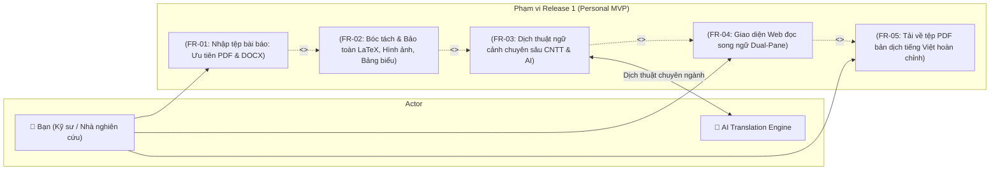
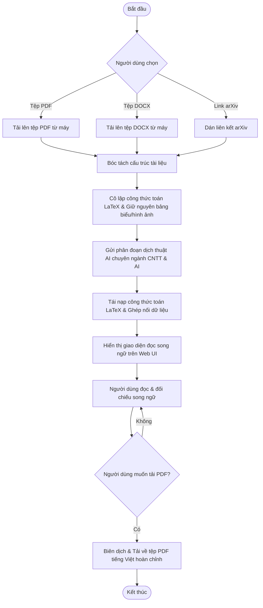

# Product Requirements Document (PRD): Release 1 (Personal Core MVP)

**Tầng tài liệu**: Implementation Layer  
**Release**: release-1 (Personal Core MVP)  
**Phiên bản**: 2.0 (Scaled Down & Focused)  
**Ngày cập nhật**: 2026-10-05  
**Tác giả**: Senior IT-BA & PO  
**Trạng thái**: Approved  
**Chất lượng yêu cầu**: 100/100  

---

## 1. Mục tiêu Đợt Phát hành & Bối cảnh Nghiệp vụ (Business Context)

### 1.1. Mục tiêu đợt phát hành (Release Goals)
- **Tham chiếu Business Layer:** Bám sát tầm nhìn cá nhân hóa và định hướng mã nguồn mở tại [docs/business/brd.md](file:///E:/MyProject/paper-translation/docs/business/brd.md) và [docs/business/roadmap.md](file:///E:/MyProject/paper-translation/docs/business/roadmap.md).
- **Bài toán giải quyết trong Release 1:** Cung cấp một công cụ dịch bài báo học thuật cá nhân chạy trên Web UI cục bộ, tập trung giải quyết xuất sắc 4 nhu cầu cốt lõi:
  1. Hỗ trợ đa định dạng đầu vào, trong đó **ưu tiên hàng đầu là tệp PDF và DOCX** (kèm hỗ trợ link arXiv).
  2. Bóc tách và **bảo toàn nguyên vẹn 100% công thức toán học LaTeX, hình ảnh minh họa và bảng biểu**.
  3. Dịch thuật tự động chuẩn xác ngữ cảnh học thuật chuyên ngành **Công nghệ thông tin (IT)** và **Trí tuệ nhân tạo (AI / Machine Learning / Deep Learning)**.
  4. Trải nghiệm đọc **song ngữ trực quan trên Web UI** và tải về trực tiếp **tệp PDF bản dịch tiếng Việt hoàn chỉnh**.

### 1.2. Chỉ số thành công (Success Metrics & KPIs)
| Chỉ số (KPI) | Baseline hiện tại | Mục tiêu Release 1 (Personal MVP) | Phương pháp đo lường |
|---|---|---|---|
| **Bảo toàn công thức LaTeX** | Bị vỡ/mất trên Google Translate | 100% công thức LaTeX hợp lệ, giữ nguyên cú pháp | Kiểm tra kết xuất KaTeX/MathJax |
| **Bảo toàn bảng & hình ảnh** | Thường bị mất khi copy/paste dịch | 100% bảng biểu và hình ảnh được giữ nguyên trong bản dịch | Đối chiếu trực quan trên Web & PDF |
| **Hỗ trợ định dạng đầu vào** | Thường chỉ hỗ trợ văn bản thuần | Hỗ trợ trọn vẹn tệp **PDF** và **DOCX** | Thử nghiệm tải tệp thực tế |
| **Độ chuẩn thuật ngữ CNTT & AI** | Dịch sai nghĩa ngữ cảnh kỹ thuật | $\ge 95\%$ thuật ngữ AI/CNTT được dịch chuẩn xác | Đánh giá trực tiếp của chuyên gia |
| **Tải về bản dịch PDF** | Không có | 1 click tải về tệp PDF tiếng Việt hoàn chỉnh | Thao tác trên Web UI |

---

## 2. Đối tượng sử dụng trong Release này (User Persona)

### Persona: Bản thân tôi (Nhà nghiên cứu / Kỹ sư CNTT & AI)
- **Vai trò:** Người dùng duy nhất trong giai đoạn 1 (Single User).
- **Nhu cầu:** Cần đọc và hiểu nhanh các bài báo chuyên ngành CNTT & AI mới nhất; vừa đọc song ngữ để đối chiếu, vừa muốn có tệp PDF tiếng Việt đã dàn trang sạch đẹp để lưu lại hoặc in ra đọc ngoại tuyến.
- **Yêu cầu đối với công cụ:** Đơn giản, dễ chạy trên máy cá nhân, không cần đăng nhập/tài khoản phức tạp, xử lý nhanh và không làm hỏng công thức toán học hay bảng biểu.

---

## 3. Ranh giới hệ thống & Sơ đồ phạm vi (Scope & System Boundary)

### 3.1. Sơ đồ Use Case Release 1

### 3.2. Phạm vi chi tiết (Scope Definition)
- **In-Scope (Phạm vi cam kết thực hiện trong Release 1):**
  - Tiếp nhận tệp tài liệu cục bộ: **Định dạng tệp PDF** và **Định dạng tệp DOCX** (kèm hỗ trợ dán URL/ID arXiv).
  - Bóc tách cấu trúc bài báo: Tiêu đề, tác giả, abstract, các đề mục, đoạn văn, công thức toán inline (`$ $`) và display (`$$ $$`), bảng biểu và hình ảnh.
  - Cô lập công thức toán học và nội dung bảng/hình trước khi dịch để chống phá vỡ cấu trúc.
  - Dịch thuật AI chuyên sâu ngữ cảnh Công nghệ thông tin & Trí tuệ nhân tạo từ tiếng Anh sang tiếng Việt.
  - Giao diện Web hiển thị bản dịch song ngữ Dual-Pane (cột trái tiếng Anh gốc, cột phải tiếng Việt dịch) có cuộn đồng bộ và highlight phân đoạn khi nhấp chọn.
  - Tải về trực tiếp **tệp PDF bản dịch tiếng Việt hoàn chỉnh** giữ trọn vẹn công thức toán, hình ảnh và bảng biểu.
- **Out-of-Scope (Tuyệt đối không làm trong Release 1 để giữ sự đơn giản):**
  - Hệ thống đăng nhập, tài khoản người dùng, phân quyền (User Management / Auth).
  - Thanh toán hoặc giới hạn số lượng bài dịch (Quota / Billing).
  - Mạng xã hội, chia sẻ bài báo công cộng hoặc bình luận cộng đồng.

---

## 4. Quy trình Nghiệp vụ Tinh gọn (Core Workflow)

---

## 5. Yêu cầu Chức năng Tinh gọn (Functional Requirements)

| Mã yêu cầu | Tên chức năng | Mô tả nghiệp vụ | Quy tắc nghiệp vụ (Business Rules) | Mức ưu tiên |
|---|---|---|---|---|
| **FR-01** | Tiếp nhận đa định dạng tệp | Tiếp nhận tệp bài báo tải lên từ máy tính, ưu tiên hàng đầu định dạng **PDF** và **DOCX** (kèm hỗ trợ link arXiv) | Tệp PDF hoặc DOCX tối đa 50MB. Kiểm tra định dạng tệp trước khi xử lý. | P0 (Must) |
| **FR-02** | Bóc tách & Bảo toàn LaTeX, Hình, Bảng | Bóc tách cấu trúc tài liệu, cô lập tuyệt đối công thức toán LaTeX, trích xuất bảng biểu và hình ảnh | 100% công thức toán inline (`$ $`) và display (`$$ $$`) được thay bằng token bảo vệ trước khi dịch và tái nạp nguyên vẹn sau khi dịch. Hình ảnh và bảng biểu giữ nguyên vị trí trong bài. | P0 (Must) |
| **FR-03** | Dịch thuật ngữ cảnh chuyên sâu CNTT & AI | Dịch thuật tự động ngữ cảnh các phân đoạn từ tiếng Anh sang tiếng Việt | Sử dụng prompt ngữ cảnh chuyên ngành IT & AI (Machine Learning, Deep Learning, NLP, Computer Vision) để đảm bảo câu dịch tự nhiên và chuẩn thuật ngữ học thuật. | P0 (Must) |
| **FR-04** | Giao diện Web đọc song ngữ (Dual-Pane) | Hiển thị 2 cột song song văn bản gốc tiếng Anh và bản dịch tiếng Việt trên trình duyệt | Hỗ trợ cuộn đồng bộ mượt mà (Synchronized Scroll) và làm nổi bật phân đoạn đối ứng khi nhấp chuột. | P0 (Must) |
| **FR-05** | Tải về tệp PDF bản dịch tiếng Việt | Xuất và tải về trực tiếp tệp PDF tiếng Việt hoàn chỉnh | Tệp PDF xuất ra phải giữ nguyên vẹn công thức toán học, bảng biểu và hình ảnh minh họa, căn lề và bố cục trang chuẩn học thuật. | P0 (Must) |

---

## 6. Rào chắn Kiến trúc cho Release này (Architecture Guardrails)

> ⛔ **Bắt buộc tuân thủ tính tinh giản:** AI Coding Agent và kỹ sư khi triển khai Release 1 phải tuân thủ nghiêm ngặt các rào chắn sau:

1. **Rào chắn Simplicity First (Đơn giản là trên hết):** Không thêm bất kỳ bảng cơ sở dữ liệu hoặc logic code nào cho việc phân quyền người dùng, token JWT hoặc quản lý tổ chức.
2. **Rào chắn Bảo toàn Học thuật:** Đảm bảo bộ bóc tách PDF (`PyMuPDF / pdfminer`) và DOCX (`python-docx`) không làm mất hoặc cắt cụt các công thức toán LaTeX, hình ảnh và bảng biểu.
3. **Rào chắn Kết xuất PDF:** Tệp PDF tải về chỉ cần là bản dịch tiếng Việt hoàn chỉnh (được dàn trang sạch sẽ), không cần tạo các tệp phụ trợ phức tạp nếu người dùng không yêu cầu.

---

## 7. Kế hoạch Bàn giao Kỹ thuật tiếp theo

1. Cập nhật nhẹ các tài liệu kiến trúc kỹ thuật liên quan ([docs/architecture/02-high-level-architecture.md](file:///E:/MyProject/paper-translation/docs/architecture/02-high-level-architecture.md), [05-data-architecture.md](file:///E:/MyProject/paper-translation/docs/architecture/05-data-architecture.md)) để phản ánh bộ bóc tách DOCX và luồng xuất PDF tinh gọn.
2. Điều chỉnh lại Sổ cái Backlog và danh sách User Stories trong [docs/implementation/release-1/backlog/](file:///E:/MyProject/paper-translation/docs/implementation/release-1/backlog/) để tập trung vào 5 FR cốt lõi trên.
