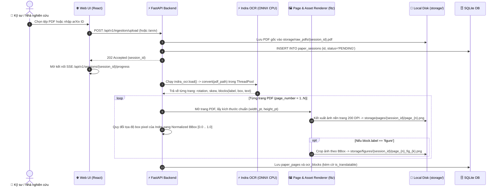
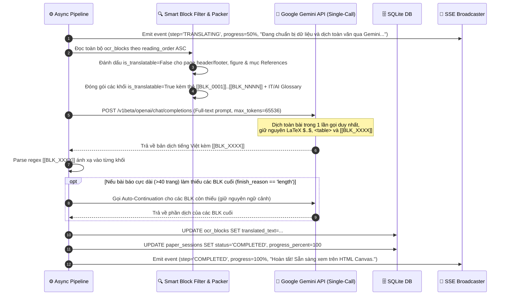
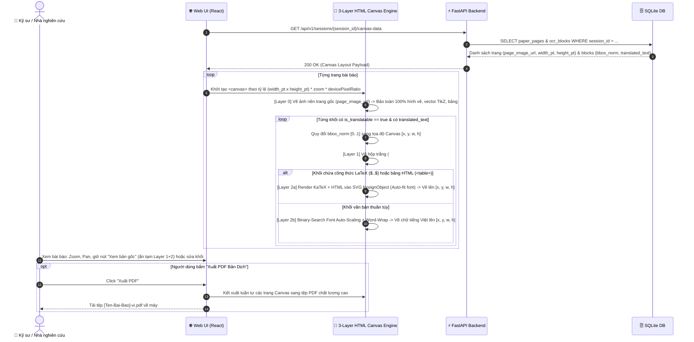

# Thiết Kế Kỹ Thuật Chi Tiết (Technical Design) — Release 1 (v3.1)

**Tầng tài liệu**: Implementation Layer  
**Release**: release-1 (Personal Core MVP)  
**Phiên bản**: 3.1 (Reviewed & Hardened — Indra OCR, Single-Call Gemini & 3-Layer HTML Canvas)  
**Nguồn tham chiếu**: PRD [docs/implementation/release-1/prd.md](file:///E:/MyProject/paper-translation/docs/implementation/release-1/prd.md)  
**Kiến trúc tham chiếu**: [docs/architecture/02-high-level-architecture.md](file:///E:/MyProject/paper-translation/docs/architecture/02-high-level-architecture.md) & [docs/architecture/05-data-architecture.md](file:///E:/MyProject/paper-translation/docs/architecture/05-data-architecture.md)  
**Ngày cập nhật**: 2026-10-22  
**Trạng thái**: Approved  

---

## 1. Tổng quan Luồng Kỹ thuật Release 1 (v3.1)

Thiết kế kỹ thuật v3.1 bao gồm 4 luồng xử lý chính đã được gia cố để loại bỏ mọi rủi ro lệch tọa độ, mất sơ đồ vector, lỗi hiển thị công thức LaTeX trên Canvas và chạm trần output token:
1. **Tiếp nhận tài liệu (Ingestion):** Nhận tệp PDF hoặc tải tự động từ arXiv.
2. **Indra OCR, Chuẩn hóa Tọa độ `[0..1]` & Kết xuất Ảnh Nền Trang (Layer 0):** Bóc tách bố cục 2 cột, chuẩn hóa tọa độ tương đối, kết xuất ảnh nền toàn trang 200 DPI và crop các khối `figure` bằng PyMuPDF.
3. **Lọc Thông Minh & Dịch Toàn Văn 1 Lần Gọi Qua Gemini (`max_tokens=65536`):** Lọc bỏ mục `References` và `page header/footer`, đóng gói toàn văn kèm mã `[[BLK_XXXX]]`, dịch trong 1 request duy nhất kèm cơ chế Auto-Continuation Guard.
4. **Tái Hiện 3 Lớp Trên HTML Canvas & Xuất PDF:** Vẽ Layer 0 (Base Page) $\rightarrow$ Layer 1 (Smart Redaction `#FFFFFF` trên các khối dịch) $\rightarrow$ Layer 2 (Văn bản tiếng Việt Auto-Fit + KaTeX SVG) và xuất PDF.

---

## 2. Sơ đồ Tuần tự 1: Tiếp nhận PDF, Indra OCR & Chuẩn Hóa Tọa Độ

---

## 3. Sơ đồ Tuần tự 2: Bộ Lọc Thông Minh & Dịch Toàn Văn Qua Gemini Single-Call

---

## 4. Sơ đồ Tuần tự 3: Kết Xuất 3 Lớp Trên HTML Canvas & Xuất PDF

