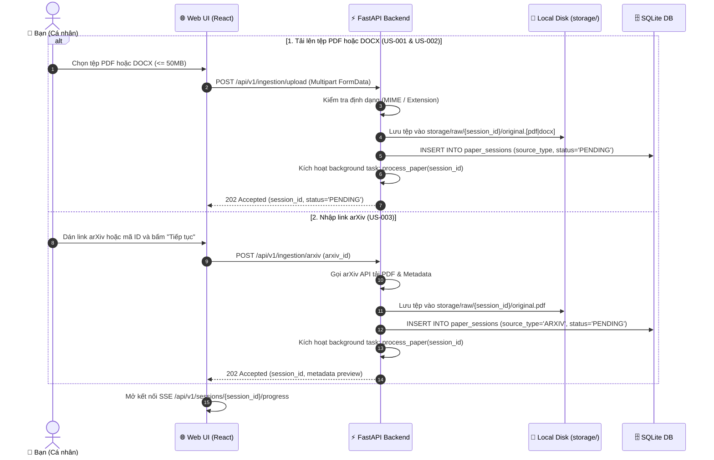
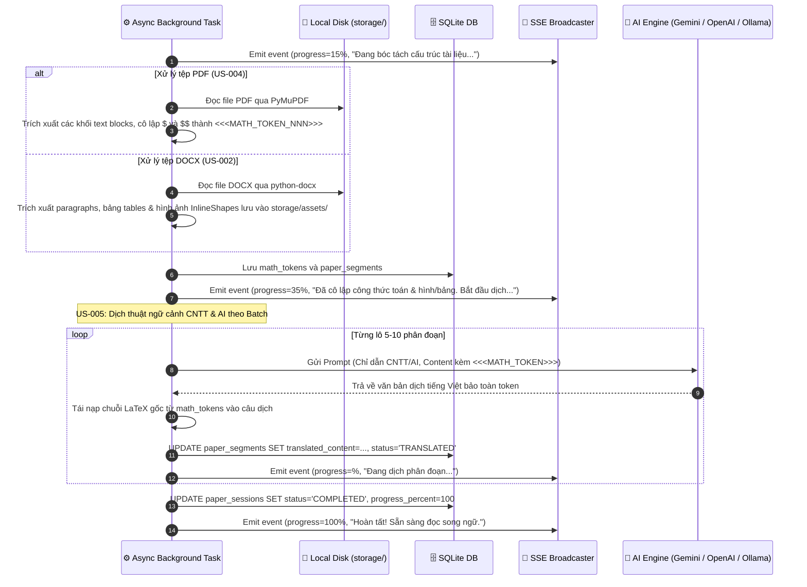
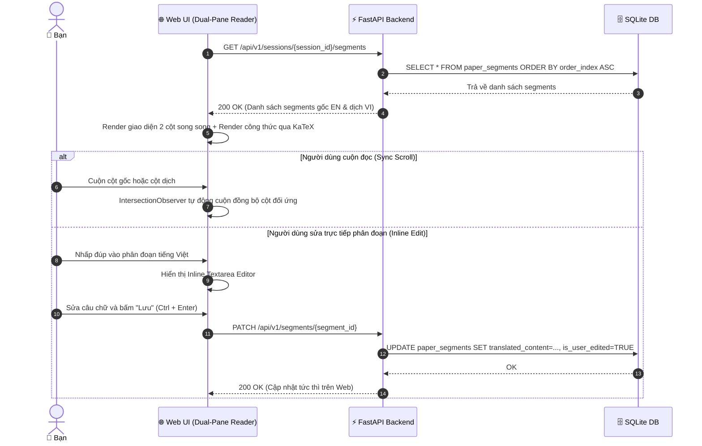

# Thiết Kế Kỹ Thuật Chi Tiết (Technical Design) — Release 1 (Personal Core MVP)

**Tầng tài liệu**: Implementation Layer  
**Release**: release-1 (Personal Core MVP)  
**Phiên bản**: 2.0 (Scaled Down & Focused)  
**Nguồn tham chiếu**: PRD [docs/implementation/release-1/prd.md](file:///E:/MyProject/paper-translation/docs/implementation/release-1/prd.md)  
**Kiến trúc tham chiếu**: [docs/architecture/02-high-level-architecture.md](file:///E:/MyProject/paper-translation/docs/architecture/02-high-level-architecture.md) & [docs/architecture/05-data-architecture.md](file:///E:/MyProject/paper-translation/docs/architecture/05-data-architecture.md)  
**Ngày cập nhật**: 2026-10-05  
**Trạng thái**: Approved  

---

## 1. Tổng quan Luồng Kỹ thuật Release 1

Thiết kế kỹ thuật Release 1 tập trung phục vụ trải nghiệm cá nhân mượt mà với 4 luồng tuần tự (Sequence Flows) chính:
1. **Tiếp nhận đa định dạng:** Hỗ trợ upload tệp **PDF**, tệp **DOCX** và dán link **arXiv**.
2. **Bóc tách & Bảo toàn:** Bóc tách văn bản, cô lập công thức toán LaTeX, trích xuất hình ảnh minh họa và bảng biểu.
3. **Dịch thuật ngữ cảnh CNTT & AI:** Gom lô phân đoạn, gửi qua LLM và tái nạp công thức toán LaTeX.
4. **Giao diện Web song ngữ & Tải PDF bản dịch:** Hiển thị đối xứng 2 cột trên trình duyệt và cho phép tải về tệp PDF tiếng Việt hoàn chỉnh giữ 100% LaTeX, hình, bảng.

---

## 2. Sơ đồ Tuần tự 1: Tiếp nhận Đa định dạng (PDF & DOCX & arXiv)



---

## 3. Sơ đồ Tuần tự 2: Bóc tách, Cô lập Toán học & Dịch thuật CNTT/AI



---

## 4. Sơ đồ Tuần tự 3: Đọc Song Ngữ trên Web UI (US-006 & US-007)



---

## 5. Sơ đồ Tuần tự 4: Tải về Tệp PDF Bản Dịch Tiếng Việt (US-008)

```mermaid
sequenceDiagram
    autonumber
    actor User as 👤 Bạn
    participant Browser as 🌐 Web UI
    participant API as ⚡ FastAPI Backend
    participant DB as 🗄️ SQLite DB
    participant Renderer as 📑 WeasyPrint Render Engine
    participant Storage as 📁 Local Disk

    User->>Browser: Bấm nút "Tải PDF bản dịch"
    Browser->>API: GET /api/v1/export/{session_id}/pdf
    API->>DB: Lấy tiêu đề, metadata và toàn bộ segments tiếng Việt (đã user edit nếu có)
    API->>Renderer: Nạp dữ liệu vào HTML Academic Template (nhúng KaTeX, hình ảnh & bảng)
    Renderer->>Renderer: Biên dịch CSS Paged Media A4 -> Sinh tệp PDF tiếng Việt chuẩn học thuật
    Renderer->>Storage: Lưu tệp vào storage/exports/{session_id}/translated.pdf
    API-->>Browser: 200 OK (File stream: application/pdf; filename="[Ten-Bai-Bao]-vi.pdf")
    Browser-->>User: Tự động tải tệp PDF tiếng Việt về máy tính
```
