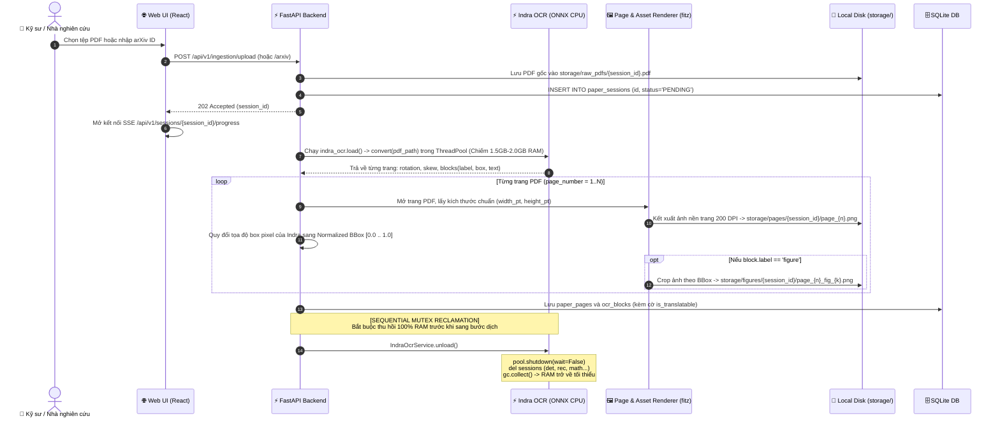
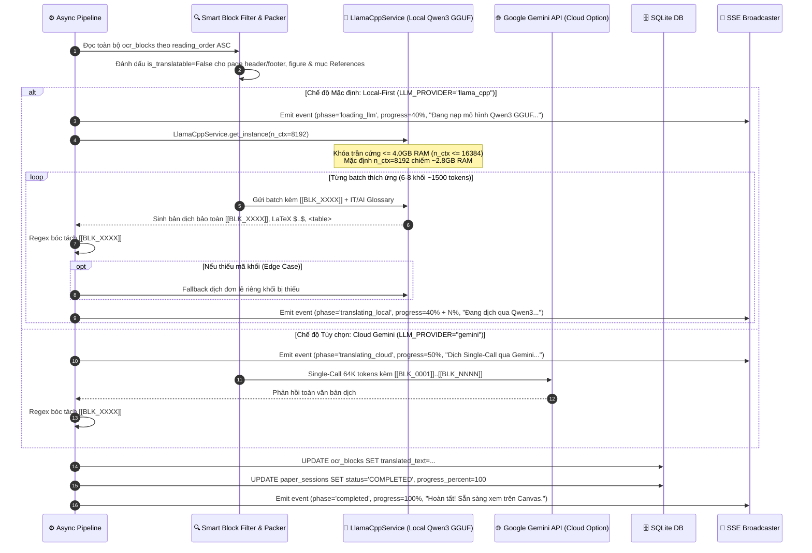
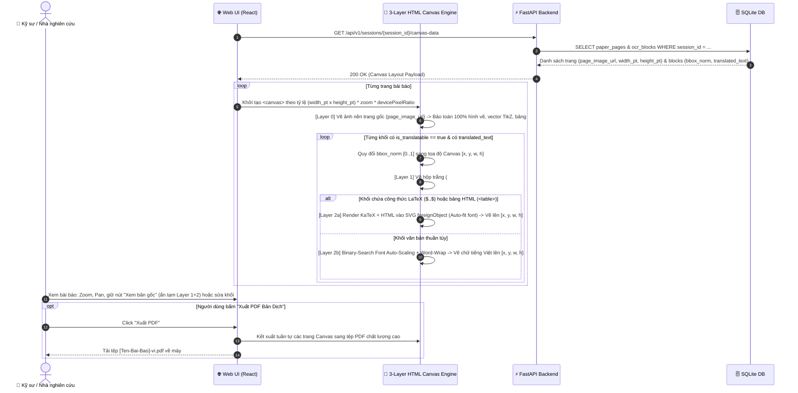

# Thiết Kế Kỹ Thuật Chi Tiết (Technical Design) — Release 1 (v3.2 Local-First)

**Tầng tài liệu**: Implementation Layer  
**Release**: release-1 (Personal Core MVP)  
**Phiên bản**: 3.2 (Local-First Priority, Sequential Mutex & 4GB Hard RAM Ceiling)  
**Nguồn tham chiếu**: PRD [docs/implementation/release-1/prd.md](file:///E:/MyProject/paper-translation/docs/implementation/release-1/prd.md)  
**Kiến trúc tham chiếu**: [docs/architecture/02-high-level-architecture.md](file:///E:/MyProject/paper-translation/docs/architecture/02-high-level-architecture.md), [docs/architecture/03-service-architecture.md](file:///E:/MyProject/paper-translation/docs/architecture/03-service-architecture.md), [docs/architecture/06-ai-architecture.md](file:///E:/MyProject/paper-translation/docs/architecture/06-ai-architecture.md)  
**Ngày cập nhật**: 2026-10-23  
**Trạng thái**: Approved  

---

## 1. Tổng quan Luồng Kỹ thuật Release 1 (v3.2 Local-First)

Thiết kế kỹ thuật v3.2 chuyển trọng tâm sang **Local-First**, bảo vệ an toàn phần cứng người dùng qua 5 luồng xử lý chính:
1. **Tiếp nhận tài liệu (Ingestion):** Nhận tệp PDF hoặc tải tự động từ arXiv.
2. **Indra OCR & Chuẩn hóa Tọa độ `[0..1]`:** Bóc tách bố cục 2 cột, chuẩn hóa tọa độ tương đối, kết xuất ảnh nền toàn trang 200 DPI và crop các khối `figure` bằng PyMuPDF.
3. **Thu Hồi Sạch Tài Nguyên OCR (Sequential Mutex Reclamation):** Dừng ThreadPool, giải phóng toàn bộ ONNX sessions và gọi `gc.collect()` để RAM trở về mức tối thiểu trước khi nạp LLM.
4. **Động Cơ Dịch Local-First (llama.cpp & Qwen3 GGUF với Trần Cứng $\le 4.0\text{ GB}$ RAM):** Nạp `Qwen3-1.7B-Q4_K_M.gguf` với `n_ctx=8192` (~2.8GB RAM), khóa trần $n\_ctx \le 16384$, thực thi dịch qua Adaptive Batching (~1500 tokens / batch). Cho phép tùy chọn Cloud Gemini Single-Call.
5. **Tái Hiện 3 Lớp Trên HTML Canvas, Hiển Thị UI Engine Indicator & Xuất PDF:** Vẽ Layer 0 (Base Page) $\rightarrow$ Layer 1 (Smart Redaction `#FFFFFF`) $\rightarrow$ Layer 2 (Auto-Fit Text + KaTeX SVG), hiển thị huy hiệu trạng thái Engine trên UI và xuất PDF 1-click.

---

## 2. Sơ đồ Tuần tự 1: Tiếp nhận PDF, Indra OCR & Thu Hồi Tài Nguyên Tuần Tự



---

## 3. Sơ đồ Tuần tự 2: Dịch Thuật Local-First (Llama.cpp Qwen3 $\le$ 4GB RAM) Hoặc Cloud Gemini



---

## 4. Sơ đồ Tuần tự 3: Kết Xuất 3 Lớp Trên HTML Canvas & Xuất PDF



---

## 5. Đặc Tả Hợp Đồng API Chỉ Báo Trạng Thái Engine (UI Engine Status Contract)

### 5.1. Endpoint: `GET /api/v1/system/engine-status`
- **Mục đích:** Cung cấp thông tin thời gian thực về Engine dịch thuật đang kích hoạt và mức giới hạn tài nguyên cho Frontend hiển thị huy hiệu trên Header.
- **Phản hồi mẫu (JSON):**
```json
{
  "active_provider": "llama_cpp",
  "is_local": true,
  "model_name": "Qwen3-1.7B-Q4_K_M.gguf",
  "context_window": 8192,
  "hard_ram_ceiling_gb": 4.0,
  "estimated_ram_usage_gb": 2.8,
  "sequential_mutex_status": "READY",
  "ocr_active": false
}
```

### 5.2. Endpoint: `POST /api/v1/system/engine-switch`
- **Mục đích:** Cho phép người dùng chuyển đổi qua lại giữa `llama_cpp` (Local-First) và `gemini` (Cloud).
- **Yêu cầu (JSON):** `{"provider": "llama_cpp" | "gemini"}`.
- **Cơ chế:** Khi chuyển sang `gemini`, nếu `llama_cpp` đang nạp, hệ thống kích hoạt `unload()` để trả lại RAM. Ngược lại, khi chuyển sang `llama_cpp`, kiểm tra tệp GGUF và nạp Singleton an toàn dưới 4GB RAM.
