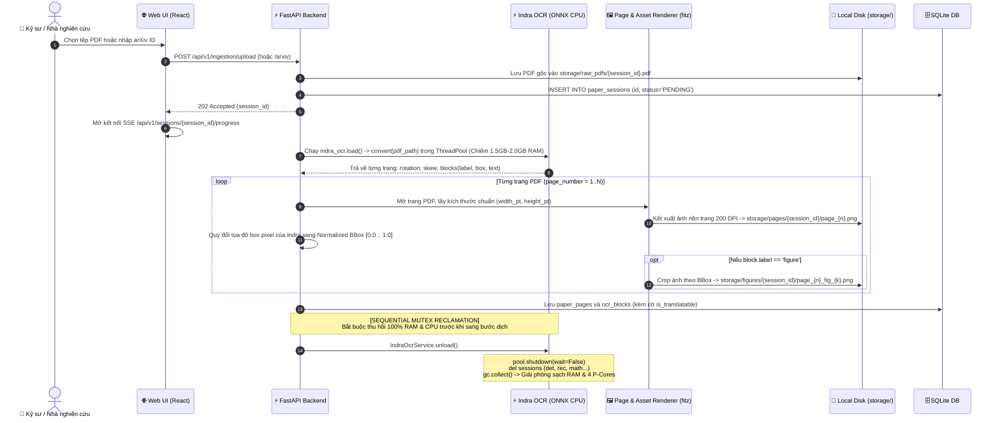
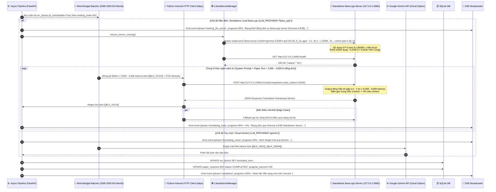
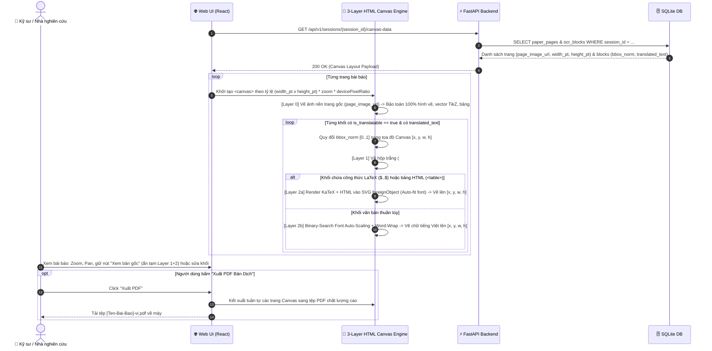

# Thiết Kế Kỹ Thuật Chi Tiết (Technical Design) — Release 1 (v3.3 Standalone Local-First)

**Tầng tài liệu**: Implementation Layer  
**Release**: release-1 (Personal Core MVP)  
**Phiên bản**: 3.3 (Standalone `llama.cpp` Server, `Gemma-4-E2B`, 4 P-Cores i5-13500H, 8GB Hard RAM Ceiling & 2000-2500 EN Words Batching)  
**Nguồn tham chiếu**: PRD [docs/implementation/release-1/prd.md](file:///E:/MyProject/paper-translation/docs/implementation/release-1/prd.md)  
**Kiến trúc tham chiếu**: [docs/architecture/02-high-level-architecture.md](file:///E:/MyProject/paper-translation/docs/architecture/02-high-level-architecture.md), [docs/architecture/03-service-architecture.md](file:///E:/MyProject/paper-translation/docs/architecture/03-service-architecture.md), [docs/architecture/06-ai-architecture.md](file:///E:/MyProject/paper-translation/docs/architecture/06-ai-architecture.md)  
**Ngày cập nhật**: 2026-10-23  
**Trạng thái**: Approved  

---

## 1. Tổng quan Luồng Kỹ thuật Release 1 (v3.3 Standalone Local-First)

Thiết kế kỹ thuật v3.3 tách biệt hoàn toàn tiến trình suy luận LLM ra khỏi tiến trình FastAPI và tối ưu hóa cho phần cứng **Intel Core i5-13500H** qua 5 luồng xử lý chính:
1. **Tiếp nhận tài liệu (Ingestion):** Nhận tệp PDF hoặc tải tự động từ arXiv.
2. **Indra OCR & Chuẩn hóa Tọa độ `[0..1]`:** Bóc tách bố cục 2 cột, chuẩn hóa tọa độ tương đối, kết xuất ảnh nền toàn trang 200 DPI và crop các khối `figure` bằng PyMuPDF.
3. **Thu Hồi Sạch Tài Nguyên OCR (Sequential Mutex Reclamation):** Dừng ThreadPool, giải phóng toàn bộ ONNX sessions và gọi `gc.collect()` để trả lại 100% RAM và 4 nhân P-cores trước khi gọi LLM.
4. **Dịch Vụ Serving Độc Lập (`llama.cpp` Server + `gemma-4-E2B-it-qat-UD-Q4_K_XL.gguf`):**
   - Backend quản lý một tiến trình riêng chạy `llama.cpp server` gốc (cài qua `uv/pip`), cấu hình **4 P-cores trên Intel Core i5-13500H (`-t 4 -tb 4`)**, bật tăng tốc phần cứng (`--flash-attn`), giới hạn **RAM $\le 8.0\text{ GB}$**, cửa sổ ngữ cảnh **16K (`n_ctx=16384`)** (hoặc tùy chọn 8K).
   - **Python Client** của Backend đóng gói mỗi lượt gọi gồm **System Prompt + Text bài báo = 2,000 – 2,500 từ tiếng Anh** (~3,000 – 3,800 tokens) và giao tiếp qua mạng nội bộ (`http://127.0.0.1:8081/v1/chat/completions`) với `max_tokens=10240` (dự phòng gấp **2.0 – 2.5 lần** cho tiếng Việt) để không bao giờ tràn context.
5. **Tái Hiện 3 Lớp Trên HTML Canvas, Hiển Thị UI Engine Indicator & Xuất PDF:** Vẽ Layer 0 (Base Page) $\rightarrow$ Layer 1 (Smart Redaction `#FFFFFF`) $\rightarrow$ Layer 2 (Auto-Fit Text + KaTeX SVG), hiển thị huy hiệu trạng thái Engine trên UI và xuất PDF 1-click.

---

## 2. Sơ đồ Tuần tự 1: Tiếp nhận PDF, Indra OCR & Thu Hồi Tài Nguyên Tuần Tự



---

## 3. Sơ đồ Tuần tự 2: Dịch Thuật Qua Standalone `llama.cpp` Server (`Gemma-4-E2B` • 4 P-Cores • $\le 8\text{GB}$ RAM) Hoặc Cloud Gemini



---

## 4. Sơ đồ Tuần tự 3: Kết Xuất 3 Lớp Trên HTML Canvas & Xuất PDF



---

## 5. Đặc Tả Hợp Đồng API Chỉ Báo Trạng Thái Engine (UI Engine Status Contract v3.3)

### 5.1. Endpoint: `GET /api/v1/system/engine-status`
- **Mục đích:** Cung cấp thông tin thời gian thực về dịch vụ Standalone `llama.cpp` Server, cấu hình phần cứng 4 P-cores i5-13500H, ngân sách từ và mức giới hạn 8GB RAM.
- **Phản hồi mẫu (JSON):**
```json
{
  "active_provider": "llama_cpp",
  "serving_architecture": "standalone_llama_cpp_server",
  "internal_endpoint": "http://127.0.0.1:8081/v1/chat/completions",
  "is_local": true,
  "model_name": "gemma-4-E2B-it-qat-UD-Q4_K_XL.gguf",
  "cpu_target": "Intel Core i5-13500H (4 P-Cores)",
  "threads_config": 4,
  "hardware_acceleration": true,
  "context_window": 16384,
  "supported_context_modes": [8192, 16384],
  "input_word_budget": "2000 - 2500 English words (System Prompt + Paper Text)",
  "output_token_headroom": "10240 tokens (2.0x - 2.5x Vietnamese expansion safe)",
  "hard_ram_ceiling_gb": 8.0,
  "estimated_ram_usage_gb": 4.2,
  "sequential_mutex_status": "READY",
  "ocr_active": false,
  "llama_server_running": true
}
```
